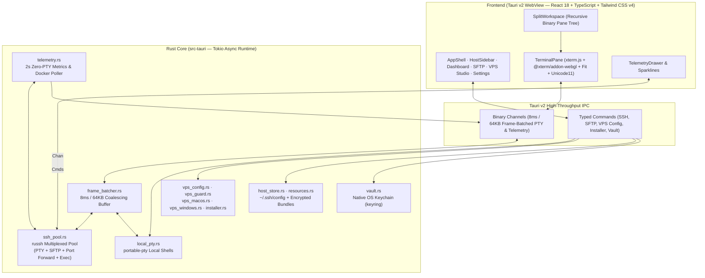

<div align="center">

<picture>
  <source media="(prefers-color-scheme: dark)" srcset="docs/brand/ssh-box-logo-dark.svg" />
  <source media="(prefers-color-scheme: light)" srcset="docs/brand/ssh-box-logo-light.svg" />
  
</picture>

<br />

### High-Performance SSH, 120fps WebGL2 Terminal & Multi-OS Server Control Center
*Trình quản lý SSH, Terminal 120fps WebGL2 & Trung tâm điều khiển máy chủ đa nền tảng*

[](https://github.com/nvdnvd00/ssh-box/releases/latest)
[](https://github.com/nvdnvd00/ssh-box/actions/workflows/release.yml)
[](https://v2.tauri.app/)
[](https://www.rust-lang.org/)
[](https://react.dev/)
[](#download)

<p align="center">
  <a href="#english"><strong>🌐 English</strong></a>
  &nbsp;·&nbsp;
  <a href="#tieng-viet"><strong>🇻🇳 Tiếng Việt</strong></a>
  &nbsp;·&nbsp;
  <a href="#download"><strong>⬇️ Download</strong></a>
  &nbsp;·&nbsp;
  <a href="#features"><strong>✨ Features</strong></a>
  &nbsp;·&nbsp;
  <a href="#architecture"><strong>🏗️ Architecture</strong></a>
  &nbsp;·&nbsp;
  <a href="#keyboard-shortcuts"><strong>⌨️ Shortcuts</strong></a>
  &nbsp;·&nbsp;
  <a href="#development"><strong>🛠️ Build</strong></a>
</p>

</div>

---

<a id="english"></a>

## ⚡ Overview

**SSH Box** is a native desktop SSH client, terminal emulator, SFTP manager, real-time server monitor, and VPS hardening studio built with **Rust (`tokio` + `russh`)**, **Tauri v2**, and **React + WebGL2 (`@xterm/addon-webgl`)**.

Designed to combine the responsiveness of **iTerm2** with the server management workflow of **Termius** and **Server Box**, SSH Box moves all SSH multiplexing, local PTY management, SFTP streaming, and telemetry polling into a multi-threaded Rust core while delivering **8ms frame-batched binary streams (120Hz)** directly to a GPU-accelerated WebGL2 glyph atlas.

---

<a id="download"></a>

## ⬇️ Download & Installation

Grab the latest prebuilt installers from [**GitHub Releases**](https://github.com/nvdnvd00/ssh-box/releases/latest):

| Platform | Architecture | Package | Direct Download |
| :--- | :--- | :--- | :--- |
| **macOS** | Universal (`Apple Silicon` + `Intel`) | `.dmg` Disk Image | [**Download `ssh-box.dmg`**](https://github.com/nvdnvd00/ssh-box/releases/latest/download/ssh-box.dmg) |
| **Windows** | `x86_64` (64-bit) | NSIS Installer (`.exe`) | [**Download `ssh-box-setup.exe`**](https://github.com/nvdnvd00/ssh-box/releases/latest/download/ssh-box-setup.exe) |
| **Linux / Source** | `x86_64` / `aarch64` | Build from source | [See Build Instructions](#development) |

> [!NOTE]
> **macOS First Launch (Gatekeeper):** The macOS Universal build is ad-hoc signed. If macOS displays an *"unidentified developer"* or *"app is damaged"* prompt on first launch, clear the quarantine attribute in Terminal:
> ```bash
> xattr -cr "/Applications/SSH Box.app"
> ```
> **Built-in Auto-Updater:** Desktop builds include cryptographic signature verification (`minisign`) and can check, download, and install new releases directly from **Settings → Updates**.

---

<a id="features"></a>

## ✨ Key Features

### 1. 🖥️ 120fps WebGL2 Terminal & Recursive Split Workspace
- **Frame-Batched Binary Pipeline (`8ms` / `64KB`):** Raw PTY bytes from remote SSH channels (`russh`) and local shells (`portable-pty`) are coalesced in Rust and streamed over `tauri::ipc::Channel` directly into `xterm.write(Uint8Array)` and rendered on the GPU via `@xterm/addon-webgl`.
- **Recursive Split Panes:** Split any terminal horizontally or vertically into an arbitrary binary tree of SSH and local shell panes (`⌘D` / `⌘⇧D` on macOS, `Alt+Shift+=` / `Alt+Shift+-` on Windows).
- **Session Persistence (`tmux` Integration):** Optional automatic `tmux` session attachment for both remote SSH hosts and local shells.
- **Quick Reconnect & Command Palette:** Instant inline reconnect on dropped connections without losing scrollback history, plus a global Command Palette (`⌘K` / `Ctrl+Shift+P`).

### 2. 🛡️ VPS Server Center & Anti-Lockout Hardening (Linux · macOS · Windows)
Configure remote servers safely through a unified visual studio with **diff previews (`old → new`)** before applying changes:
- **SSH Hardening Studio (`sshd`):**
  - Reads effective server configuration via `sshd -T` and writes clean drop-in overrides (`/etc/ssh/sshd_config.d/`).
  - **Anti-Lockout Guard:** Automatically blocks changes that would lock out your active session (e.g., disabling password authentication when connected via password without an authorized public key, or excluding your current user from `AllowUsers`).
  - **Live Canary Verification & Auto-Rollback:** When applying SSH changes (including port changes, SELinux `semanage` port labeling, and `ssh.socket` updates), SSH Box opens an independent verification connection before committing and arms an automatic server-side rollback timer if verification fails.
- **Firewall Studio:**
  - Supports **UFW**, **firewalld**, **iptables** (read-only inspection), and **Windows Defender Firewall (`NetSecurity`)**.
  - Inspect active listening sockets, enable/disable firewall protection (automatically whitelisting your active SSH port), add/delete rules, or whitelist your current client IP in one click.
- **Users & Access Keys Studio:**
  - Inspect `root` and human accounts (`UID >= 1000`), create users, toggle `sudo` privileges, lock/unlock accounts, and authorize or revoke SSH public keys directly from your SSH Box Key Vault.
- **One-Click Tool & Security Installer:**
  - Works on remote **Linux**, **macOS**, and **Windows** servers as well as your **Local Machine**.
  - Curated catalog across **Security** (`UFW`, `Fail2ban`, `Unattended Upgrades`, `Lynis`, `rkhunter`), **Apps & Runtime** (`Docker`, `Git`, `Node.js`, `Python 3`, `Nginx`), **AI** (`Claude Code`), **Network** (`Tailscale`, `curl`, `wget`), and **Utilities** (`tmux`, `htop`, `ripgrep`, `jq`).
  - Detects which package manager (`apt`, `dnf`, `snap`, `brew`, `winget`, `npm`) owns each tool, highlights stopped/disabled services, and supports live repository search & batch installation.

### 3. 📊 Real-Time Server Telemetry & Docker Management
- **Non-Intrusive Polling:** Collects metrics every `2s` over a lightweight SSH `exec` channel (no PTY allocation, zero `.bash_history` noise, no MOTD overhead) for Linux, macOS, and Windows.
- **Rich Metrics Dashboard & Drawer (`⌘I`):**
  - Overall & per-core **CPU usage** with load averages and temperature (`°C` / `°F`).
  - **Memory & Swap** allocation breakdown.
  - **Network RX/TX** real-time throughput sparklines with interface selection.
  - **Disk Volumes** capacity & mount usage, plus **Top Processes** by CPU/Memory.
- **Docker Workspace:** View running and stopped containers, inspect images, and run `start`, `stop`, `restart`, or `remove` actions directly from the GUI.

### 4. 📂 Dual-Pane SFTP File Manager
- **Local ↔ Remote Side-by-Side Browser:** Reuses the active multiplexed SSH connection without opening redundant TCP handshakes.
- **Full File Operations:** Upload and download files/folders with progress tracking, create directories/files, rename, delete, edit permissions (`chmod` via octal input or interactive checkboxes), and edit remote/local text files inline (up to `2 MB`).

### 5. 🔐 Native OS Keychain, SSH Multiplexing & Network Toolbox
- **Zero-Config `~/.ssh/config` Sync:** Automatically parses your existing `~/.ssh/config` (read-only) and merges it with custom hosts, groups, and color-coded tags.
- **Native Credential Vault:** Passwords, identity secrets, and key passphrases are stored in your OS native keychain (**macOS Keychain**, **Windows Credential Manager**, **Linux Secret Service**) via `keyring` — never stored in plaintext JSON.
- **Built-in SSH Key & Identity Manager:** Generate `Ed25519`, `RSA`, or `ECDSA P-256` key pairs, import existing private keys, and bind reusable **Identities** across multiple servers.
- **Jump Hosts, Proxies & Port Forwarding:**
  - Multi-hop **Jump Host (Bastion)** chaining and **SOCKS5 / HTTP Connect** proxy profiles.
  - Visual **Port Forwarding Manager** supporting **Local (`-L`)**, **Remote (`-R`)**, and **Dynamic SOCKS (`-D`)** tunnels with auto-start.
- **Command Snippets & Encrypted Backup:** Organize shell snippets into packages, run them across machines with execution history, and export/import your entire setup in an **AES-256-GCM (PBKDF2)** encrypted bundle.

### 6. 🎨 Themes, Typography & Bilingual UI
- **5 App Themes:** `Zinc Dark`, `Obsidian Dark`, `Stone Dark`, `Midnight Dark`, and `Zinc Light` paired with **6 Accent Colors** (`Emerald`, `Cyan`, `Violet`, `Amber`, `Rose`, `Monokai`).
- **8 Terminal Color Presets:** `Monokai`, `Tokyo Night`, `Catppuccin Mocha`, `Dracula`, `One Dark`, `Nord`, `Obsidian`, and `Solarized Light`.
- **5 Nerd-Font-Ready Font Stacks:** `SF Mono`, `JetBrains Mono`, `Menlo`, `Fira Code`, and `System Monospace` with adjustable font size, line height, letter spacing, and cursor style (`block`, `bar`, `underline`).
- **Bilingual Interface:** Instant switch between **English** and **Tiếng Việt**.

---

<a id="architecture"></a>

## 🏗️ System Architecture



### Core Rust Modules (`src-tauri/src/`)

| Module | Responsibility |
| :--- | :--- |
| [`ssh_pool.rs`](src-tauri/src/ssh_pool.rs) | Manages multiplexed `russh` connections, jump hosts, SOCKS5/HTTP proxies, local/remote/dynamic port forwarding, and TOFU `known_hosts` verification. |
| [`frame_batcher.rs`](src-tauri/src/frame_batcher.rs) | Coalesces high-volume PTY output into `8ms` (120Hz) or `64KB` binary chunks over `tauri::ipc::Channel`. |
| [`local_pty.rs`](src-tauri/src/local_pty.rs) | Spawns and resizes local shell sessions (`zsh`, `bash`, `pwsh`, `cmd`) via `portable-pty`. |
| [`sftp.rs`](src-tauri/src/sftp.rs) | Dual-pane local and remote file operations, streaming transfers, `chmod`, and inline text editing. |
| [`telemetry.rs`](src-tauri/src/telemetry.rs) | Periodic `2s` server telemetry collector (CPU, RAM, Swap, Disk, Net RX/TX, Temperatures, Processes, Docker) across Linux, macOS, and Windows. |
| [`vps_config.rs`](src-tauri/src/vps_config.rs) & [`vps_guard.rs`](src-tauri/src/vps_guard.rs) | Multi-OS server probing, anti-lockout validation, `sshd -T` inspection, live canary connection verification, auto-rollback scheduling, firewall, and user/key management. |
| [`installer.rs`](src-tauri/src/installer.rs) | Cross-platform package manager detection, curated security/dev tool catalog ([`installer_catalog.json`](src-tauri/src/installer_catalog.json)), service state checks, and batch installer. |
| [`vault.rs`](src-tauri/src/vault.rs) & [`host_store.rs`](src-tauri/src/host_store.rs) | OS-native credential storage (`keyring`), `~/.ssh/config` merging, and AES-256-GCM encrypted resource export/import. |

---

<a id="keyboard-shortcuts"></a>

## ⌨️ Default Keyboard Shortcuts

All shortcuts can be customized in **Settings → Shortcuts** (except OS-native Paste).

| Action | macOS | Windows / Linux |
| :--- | :--- | :--- |
| **Command Palette** | `⌘ K` | `Ctrl + Shift + P` |
| **New Local Tab** | `⌘ T` | `Ctrl + Shift + T` |
| **Split Vertically** | `⌘ D` | `Alt + Shift + =` |
| **Split Horizontally** | `⌘ ⇧ D` | `Alt + Shift + -` |
| **Close Active Pane** | `⌘ W` | `Ctrl + Shift + W` |
| **Next / Previous Pane** | `⌘ ]` / `⌘ [` | `Alt + →` / `Alt + ←` |
| **Next / Previous Tab** | `⌘ ⇧ ]` / `⌘ ⇧ [` | `Ctrl + Tab` / `Ctrl + Shift + Tab` |
| **Switch to Tab 1 – 9** | `⌘ 1` … `⌘ 9` | `Ctrl + Alt + 1` … `9` |
| **Toggle Telemetry Monitor** | `⌘ I` | `Ctrl + Shift + I` |
| **Open Settings** | `⌘ ,` | `Ctrl + ,` |
| **Find in Terminal** | `⌘ F` | `Ctrl + Shift + F` |
| **Clear Terminal** | `⌘ ⇧ K` | `Ctrl + Shift + K` |
| **Copy / Paste** | `⌘ C` / `⌘ V` | `Ctrl + Shift + C` / `Ctrl + V` |
| **Zoom In / Out / Reset** | `⌘ =` / `⌘ -` / `⌘ 0` | `Ctrl + =` / `Ctrl + -` / `Ctrl + 0` |

---

<a id="development"></a>

## 🛠️ Development & Building from Source

### Prerequisites
- **Node.js** `>= 20` (v22 recommended) & `npm`
- **Rust** stable toolchain (`rustup`, `cargo`)
- Platform-specific Tauri v2 dependencies ([Tauri v2 Prerequisites Guide](https://v2.tauri.app/start/prerequisites/))

### Quick Start

```bash
# 1. Clone the repository
git clone https://github.com/nvdnvd00/ssh-box.git
cd ssh-box

# 2. Install frontend dependencies
npm install

# 3. Run in development mode (hot-reload frontend + Rust backend)
npx tauri dev
```

### Production Builds & Testing

```bash
# Type-check and build frontend bundle
npm run build

# Run Rust unit and matrix tests
cargo test --manifest-path src-tauri/Cargo.toml

# Build native desktop installer for your current OS
npx tauri build

# Cross-compile Windows NSIS installer from macOS/Linux (requires cargo-xwin)
npm run tauri:build:win
```

---
---

<a id="tieng-viet"></a>

<div align="center">

## 🇻🇳 Tài Liệu Tiếng Việt

**SSH Box** — Ứng dụng quản lý SSH, Terminal 120fps WebGL2, SFTP 2 cột, Giám sát tài nguyên thời gian thực và Trung tâm cấu hình bảo mật máy chủ (Linux · macOS · Windows).

</div>

### 🌟 Điểm nổi bật

1. **⚡ Terminal 120fps WebGL2 & Chia khung đệ quy (Split Panes):**
   - Toàn bộ tầng mạng SSH (`russh`) và Local PTY (`portable-pty`) chạy trên nhân **Rust bất đồng bộ (`tokio`)**.
   - Cơ chế **Frame-Batched Binary Streaming (`8ms` / `64KB`)** gom luồng byte nhị phân qua `tauri::ipc::Channel` đẩy thẳng lên bộ vẽ **WebGL2 GPU** (`@xterm/addon-webgl`), giữ tốc độ mượt 120fps ngay cả khi chạy `btop`, `tmux`, `nvim` hoặc xả log lớn.
   - Chia đôi màn hình dọc/ngang nhiều tầng như iTerm2 (`⌘D` / `⌘⇧D`), tự động gắn phiên `tmux` (tuỳ chọn), tìm kiếm trong terminal và bảng lệnh nhanh (`⌘K`).

2. **🛡️ Cấu hình VPS & Chống tự khoá máy chủ (Linux · macOS · Windows):**
   - **Bảo mật SSH (`sshd`):** Đọc cấu hình thực tế bằng `sshd -T`, ghi file drop-in chuẩn, đi kèm **Bộ chặn tự khoá (Anti-Lockout Guard)** ở backend. Mọi thay đổi đều có bảng **Xem trước (`cũ → mới`)**, tự mở **kết nối thử nghiệm mới** để xác minh trước khi giữ cấu hình, và tự động hoàn tác (rollback) nếu mất kết nối.
   - **Tường lửa (Firewall Studio):** Hỗ trợ `UFW`, `firewalld`, `iptables` (chỉ xem) và `Windows Defender Firewall`. Xem danh sách cổng đang lắng nghe, bật/tắt tường lửa (tự động mở cổng SSH hiện tại), thêm/xoá rule và cho phép nhanh IP hiện tại của bạn.
   - **Người dùng & Khoá truy cập (Users & Keys):** Quản lý tài khoản hệ thống, quyền `sudo`, khoá/mở khoá user và cấp/thu hồi trực tiếp SSH Public Key từ kho khoá của SSH Box.
   - **Trình cài đặt công cụ (Tool Installer):** Cài đặt 1 chạm các công cụ Bảo mật (`UFW`, `Fail2ban`, `Unattended Upgrades`, `Lynis`, `rkhunter`), Ứng dụng (`Docker`, `Git`, `Node.js`, `Python 3`, `Nginx`), AI (`Claude Code`), Mạng (`Tailscale`) và Tiện ích (`tmux`, `htop`, `ripgrep`, `jq`) hoặc tìm kiếm trực tiếp trên `apt`, `dnf`, `snap`, `brew`, `winget`, `npm` cho cả máy chủ từ xa lẫn **Máy này (Local)**.

3. **📊 Giám sát máy chủ thời gian thực & Quản lý Docker:**
   - Lấy thông số định kỳ mỗi `2 giây` qua kênh `exec` (không tạo PTY giả, không làm bẩn `.bash_history`): `%CPU` từng nhân, nhiệt độ CPU, `RAM`, `Swap`, tốc độ mạng `RX/TX`, ổ đĩa và tiến trình tiêu thụ tài nguyên cao nhất.
   - Quản lý **Docker Containers & Images** trực quan: bật, tắt, khởi động lại, xoá container/image ngay trong giao diện.

4. **📂 Trình quản lý file SFTP 2 cột (Local ↔ Remote):**
   - Duyệt file song song giữa máy cục bộ và máy chủ từ xa trên cùng kết nối SSH Multiplexed.
   - Hỗ trợ tải lên/tải xuống, tạo mới, đổi tên, xoá, phân quyền `chmod` (nhập số octal hoặc tích chọn) và sửa nhanh file văn bản trực tiếp (tối đa `2 MB`).

5. **🔐 Khoá bảo mật hệ điều hành, Proxy, Port Forwarding & Sao lưu mã hoá:**
   - Tự động đọc `~/.ssh/config` (chế độ chỉ đọc) kết hợp với danh sách máy chủ tuỳ chỉnh, phân nhóm và gắn thẻ màu.
   - Lưu mật khẩu và passphrase an toàn trong **macOS Keychain**, **Windows Credential Manager**, hoặc **Linux Secret Service**.
   - Hỗ trợ **Jump Host (Bastion)**, **Proxy SOCKS5 / HTTP Connect**, **Port Forwarding** (`Local -L`, `Remote -R`, `Dynamic -D`), quản lý **Snippets** và xuất/nhập toàn bộ dữ liệu bằng gói **mã hoá AES-256-GCM (PBKDF2)**.

### ⬇️ Tải xuống nhanh

- **macOS (Universal — Apple Silicon & Intel):** [**Tải `ssh-box.dmg`**](https://github.com/nvdnvd00/ssh-box/releases/latest/download/ssh-box.dmg)
  *(Nếu mở lần đầu bị macOS Gatekeeper chặn, chạy lệnh: `xattr -cr "/Applications/SSH Box.app"`)*
- **Windows (64-bit Installer):** [**Tải `ssh-box-setup.exe`**](https://github.com/nvdnvd00/ssh-box/releases/latest/download/ssh-box-setup.exe)
- **Tự động cập nhật:** Tích hợp sẵn trình kiểm tra và cập nhật phiên bản mới có chữ ký số ngay trong mục **Cài đặt → Cập nhật**.

---

<div align="center">
  <sub>Built with ❤️ using Rust, Tauri v2, React, and WebGL2 · <a href="https://github.com/nvdnvd00/ssh-box">github.com/nvdnvd00/ssh-box</a></sub>
</div>
