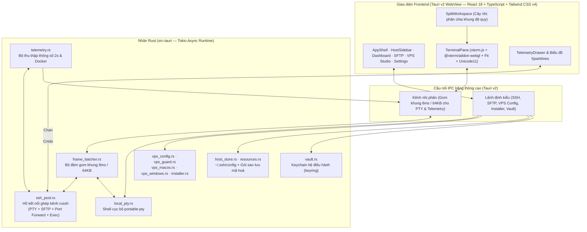

<div align="center">

<picture>
  <source media="(prefers-color-scheme: dark)" srcset="docs/brand/ssh-box-logo-dark.svg" />
  <source media="(prefers-color-scheme: light)" srcset="docs/brand/ssh-box-logo-light.svg" />
  
</picture>

<br />

### Trình quản lý SSH, Terminal 120fps WebGL2 & Trung tâm điều khiển máy chủ đa nền tảng

[](https://github.com/nvdnvd00/ssh-box/releases/latest)
[](https://github.com/nvdnvd00/ssh-box/actions/workflows/release.yml)
[](https://v2.tauri.app/)
[](https://www.rust-lang.org/)
[](https://react.dev/)
[](#download)

<p align="center">
  <a href="README.md"><strong>🌐 English</strong></a>
  &nbsp;·&nbsp;
  <strong>🇻🇳 Tiếng Việt</strong>
</p>

<p align="center">
  <a href="#download"><strong>⬇️ Tải xuống</strong></a>
  &nbsp;·&nbsp;
  <a href="#features"><strong>✨ Tính năng</strong></a>
  &nbsp;·&nbsp;
  <a href="#architecture"><strong>🏗️ Kiến trúc</strong></a>
  &nbsp;·&nbsp;
  <a href="#keyboard-shortcuts"><strong>⌨️ Phím tắt</strong></a>
  &nbsp;·&nbsp;
  <a href="#development"><strong>🛠️ Tự build</strong></a>
</p>

</div>

---

## ⚡ Tổng quan

**SSH Box** là ứng dụng desktop quản lý kết nối SSH, giả lập Terminal tốc độ cao, duyệt file SFTP 2 cột, giám sát tài nguyên máy chủ thời gian thực và cấu hình bảo mật VPS được xây dựng bằng **Rust (`tokio` + `russh`)**, **Tauri v2**, và **React + WebGL2 (`@xterm/addon-webgl`)**.

Lấy cảm hứng từ độ mượt của **iTerm2** kết hợp cùng quy trình quản trị máy chủ trực quan của **Termius** và **Server Box**, SSH Box đưa toàn bộ tầng ghép kênh SSH (multiplexing), Local PTY, truyền tải SFTP và bộ thu thập thông số xuống nhân Rust đa luồng, đồng thời truyền dữ liệu nhị phân theo khung **`8ms` (120Hz)** thẳng lên bộ dựng hình **WebGL2 GPU**.

---

<a id="download"></a>

## ⬇️ Tải xuống & Cài đặt

Tải bộ cài đặt mới nhất tại [**GitHub Releases**](https://github.com/nvdnvd00/ssh-box/releases/latest):

| Nền tảng | Kiến trúc | Định dạng | Liên kết tải trực tiếp |
| :--- | :--- | :--- | :--- |
| **macOS** | Universal (`Apple Silicon` + `Intel`) | Ảnh đĩa `.dmg` | [**Tải `ssh-box.dmg`**](https://github.com/nvdnvd00/ssh-box/releases/latest/download/ssh-box.dmg) |
| **Windows** | `x86_64` (64-bit) | Bộ cài NSIS (`.exe`) | [**Tải `ssh-box-setup.exe`**](https://github.com/nvdnvd00/ssh-box/releases/latest/download/ssh-box-setup.exe) |
| **Linux / Mã nguồn** | `x86_64` / `aarch64` | Biên dịch từ nguồn | [Xem hướng dẫn tự build](#development) |

> [!NOTE]
> **Mở lần đầu trên macOS (Gatekeeper):** Bản build macOS Universal được ký ad-hoc. Nếu macOS hiện thông báo *"unidentified developer"* hoặc *"app is damaged"* khi mở lần đầu, hãy gỡ cờ cách ly trong Terminal:
> ```bash
> xattr -cr "/Applications/SSH Box.app"
> ```
> **Tự động cập nhật (Auto-Updater):** Ứng dụng tích hợp sẵn cơ chế kiểm tra và cài đặt bản cập nhật mới có xác thực chữ ký số (`minisign`) ngay trong **Cài đặt → Cập nhật**.

---

<a id="features"></a>

## ✨ Tính năng nổi bật

### 1. 🖥️ Terminal 120fps WebGL2 & Chia khung đệ quy (Split Panes)
- **Đường ống nhị phân gom khung (`8ms` / `64KB`):** Luồng byte thô từ kênh SSH (`russh`) và shell nội bộ (`portable-pty`) được gom tại nhân Rust rồi đẩy qua `tauri::ipc::Channel` thẳng vào `xterm.write(Uint8Array)` và vẽ trên GPU bằng `@xterm/addon-webgl`, giữ tốc độ ổn định khi chạy `btop`, `tmux`, `nvim` hoặc xả log lớn.
- **Chia đôi màn hình đệ quy:** Chia ngang hoặc dọc bất kỳ khung terminal nào thành cây nhị phân kết hợp cả phiên SSH lẫn Local shell (`⌘D` / `⌘⇧D` trên macOS, `Alt+Shift+=` / `Alt+Shift+-` trên Windows).
- **Duy trì phiên làm việc (`tmux`):** Tuỳ chọn tự động gắn vào phiên `tmux` khi mở kết nối SSH hoặc shell cục bộ.
- **Kết nối lại tức thì & Bảng lệnh nhanh:** Tự động hiện nút kết nối lại ngay trên khung bị ngắt mạng mà không làm mất lịch sử log trên màn hình; hỗ trợ Command Palette toàn cục (`⌘K` / `Ctrl+Shift+P`).

### 2. 🛡️ Trung tâm cấu hình VPS & Chống tự khoá (Linux · macOS · Windows)
Cấu hình máy chủ từ xa an toàn với hộp thoại **Xem trước thay đổi (`cũ → mới`)** trước khi áp dụng:
- **Bảo mật SSH (`sshd`):**
  - Đọc cấu hình thực tế đang có hiệu lực bằng `sshd -T` và ghi vào file drop-in (`/etc/ssh/sshd_config.d/`).
  - **Bộ chặn tự khoá (Anti-Lockout Guard):** Tự động ngăn các thao tác có nguy cơ khoá chính phiên đang dùng (ví dụ: tắt đăng nhập mật khẩu khi phiên hiện tại đang dùng mật khẩu mà chưa có SSH key hợp lệ, hoặc cấu hình `AllowUsers` bỏ sót user hiện tại).
  - **Xác minh bằng kết nối thử mới & Tự động hoàn tác (Auto-Rollback):** Khi áp dụng thay đổi SSH (bao gồm đổi cổng, tự gắn nhãn SELinux `semanage` và cập nhật `ssh.socket`), SSH Box tự mở một kết nối độc lập mới để kiểm tra trước khi chốt và kích hoạt bộ hẹn giờ tự hoàn tác trên máy chủ nếu kết nối thử thất bại.
- **Tường lửa (Firewall Studio):**
  - Hỗ trợ **UFW**, **firewalld**, **iptables** (chế độ chỉ xem) và **Windows Defender Firewall (`NetSecurity`)**.
  - Xem danh sách các cổng đang lắng nghe, bật/tắt tường lửa (tự động thêm rule bảo vệ cổng SSH đang kết nối), thêm/xoá rule hoặc cho phép nhanh địa chỉ IP hiện tại của bạn chỉ với 1 cú nhấp.
- **Người dùng & Khoá truy cập (Users & Access Keys):**
  - Xem danh sách tài khoản hệ thống (`root` và `UID >= 1000`), tạo người dùng mới, cấp/thu hồi quyền `sudo`, khoá/mở khoá tài khoản, và cấp hoặc thu hồi SSH Public Key trực tiếp từ kho khoá của SSH Box.
- **Trình cài đặt công cụ & bảo mật 1 chạm (Tool Installer):**
  - Hoạt động trên cả máy chủ **Linux**, **macOS**, **Windows** từ xa lẫn **Máy này (Local)**.
  - Danh mục chọn lọc theo nhóm: **Bảo mật** (`UFW`, `Fail2ban`, `Unattended Upgrades`, `Lynis`, `rkhunter`), **Chạy ứng dụng** (`Docker`, `Git`, `Node.js`, `Python 3`, `Nginx`), **AI** (`Claude Code`), **Mạng** (`Tailscale`, `curl`, `wget`) và **Tiện ích** (`tmux`, `htop`, `ripgrep`, `jq`).
  - Tự nhận diện trình quản lý gói (`apt`, `dnf`, `snap`, `brew`, `winget`, `npm`) đã cài từng công cụ, cảnh báo dịch vụ đang tắt/dừng, hỗ trợ tìm kiếm trực tiếp trên kho gói và cài đặt hàng loạt.

### 3. 📊 Giám sát tài nguyên thời gian thực & Quản lý Docker
- **Thu thập không xâm lấn:** Lấy mẫu định kỳ mỗi `2 giây` qua kênh `exec` nhẹ của SSH (không cấp phát PTY, không kích hoạt `.bashrc`/MOTD, không làm bẩn `.bash_history`) cho cả Linux, macOS và Windows.
- **Bảng Dashboard & Ngăn giám sát nhanh (`⌘I`):**
  - Mức sử dụng **CPU tổng và từng nhân**, tải trung bình (load average) và nhiệt độ (`°C` / `°F`).
  - Chi tiết dung lượng **RAM & Swap**.
  - Biểu đồ tốc độ mạng **RX/TX** thời gian thực theo từng card mạng.
  - Dung lượng các phân vùng **Ổ đĩa** và danh sách **Tiến trình (Top Processes)** tiêu thụ nhiều CPU/RAM nhất.
- **Quản lý Docker:** Xem danh sách container đang chạy/đã dừng, kiểm tra images và thực hiện `start`, `stop`, `restart`, `remove` ngay trên giao diện đồ hoạ.

### 4. 📂 Trình quản lý file SFTP 2 cột (Local ↔ Remote)
- **Duyệt file song song 2 cột:** Tận dụng ngay kết nối SSH ghép kênh đang mở mà không cần bắt tay TCP lại.
- **Đầy đủ thao tác tệp:** Tải lên/tải xuống file và thư mục kèm thanh tiến trình, tạo thư mục/file mới, đổi tên, xoá, phân quyền `chmod` (nhập số octal hoặc tích chọn trực quan) và chỉnh sửa trực tiếp file văn bản (lên tới `2 MB`).

### 5. 🔐 Keychain hệ điều hành, Ghép kênh SSH & Bộ công cụ mạng
- **Đồng bộ `~/.ssh/config` tức thì:** Tự động đọc `~/.ssh/config` (chế độ chỉ đọc) và hợp nhất với danh sách máy chủ tự tạo, nhóm máy và thẻ màu.
- **Lưu trữ mật khẩu trong Keychain gốc:** Mật khẩu máy chủ, thông tin định danh và passphrase của khoá SSH được lưu trực tiếp trong **macOS Keychain**, **Windows Credential Manager** hoặc **Linux Secret Service** thông qua `keyring` — tuyệt đối không lưu dạng văn bản rõ trên đĩa.
- **Quản lý SSH Key & Định danh (Identities):** Khởi tạo cặp khoá `Ed25519`, `RSA`, hoặc `ECDSA P-256`, nhập khoá sẵn có và gắn định danh dùng chung cho nhiều máy chủ.
- **Jump Host, Proxy & Chuyển tiếp cổng (Port Forwarding):**
  - Hỗ trợ bắc cầu qua **Jump Host (Bastion)** nhiều chặng và cấu hình **Proxy SOCKS5 / HTTP Connect**.
  - Trình quản lý **Port Forwarding** trực quan hỗ trợ **Local (`-L`)**, **Remote (`-R`)** và **Dynamic SOCKS (`-D`)** kèm tuỳ chọn tự động chạy.
- **Snippets & Sao lưu mã hoá:** Phân loại các đoạn lệnh thường dùng theo gói, chạy nhanh kèm lịch sử thực thi, và xuất/nhập toàn bộ dữ liệu dưới dạng gói **mã hoá AES-256-GCM (PBKDF2)**.

### 6. 🎨 Giao diện, Phông chữ & Đa ngôn ngữ
- **5 Chủ đề ứng dụng:** `Zinc Dark`, `Obsidian Dark`, `Stone Dark`, `Midnight Dark`, và `Zinc Light` kết hợp cùng **6 màu nhấn (Accent Colors)** (`Emerald`, `Cyan`, `Violet`, `Amber`, `Rose`, `Monokai`).
- **8 Bảng màu Terminal:** `Monokai`, `Tokyo Night`, `Catppuccin Mocha`, `Dracula`, `One Dark`, `Nord`, `Obsidian`, và `Solarized Light`.
- **5 Bộ phông chữ hỗ trợ Nerd Font:** `SF Mono`, `JetBrains Mono`, `Menlo`, `Fira Code`, và `System Monospace` với tuỳ chỉnh cỡ chữ, chiều cao dòng, khoảng cách ký tự và kiểu con trỏ (`block`, `bar`, `underline`).
- **Song ngữ Việt – Anh:** Chuyển đổi tức thì giữa **Tiếng Việt** và **English**.

---

<a id="architecture"></a>

## 🏗️ Kiến trúc hệ thống



### Các module Rust cốt lõi (`src-tauri/src/`)

| Module | Trách nhiệm |
| :--- | :--- |
| [`ssh_pool.rs`](src-tauri/src/ssh_pool.rs) | Quản lý kết nối `russh` ghép kênh, Jump Host, proxy SOCKS5/HTTP, chuyển tiếp cổng Local/Remote/Dynamic và xác thực `known_hosts` (TOFU). |
| [`frame_batcher.rs`](src-tauri/src/frame_batcher.rs) | Gom luồng dữ liệu PTY tốc độ cao theo chu kỳ `8ms` (120Hz) hoặc tối đa `64KB`/gói qua `tauri::ipc::Channel`. |
| [`local_pty.rs`](src-tauri/src/local_pty.rs) | Khởi tạo và điều chỉnh kích thước phiên shell cục bộ (`zsh`, `bash`, `pwsh`, `cmd`) thông qua `portable-pty`. |
| [`sftp.rs`](src-tauri/src/sftp.rs) | Xử lý duyệt file 2 cột Local ↔ Remote, truyền tải luồng nhị phân, phân quyền `chmod` và chỉnh sửa văn bản trực tiếp. |
| [`telemetry.rs`](src-tauri/src/telemetry.rs) | Thu thập thông số máy chủ mỗi `2s` (CPU, RAM, Swap, Disk, Net RX/TX, Nhiệt độ, Tiến trình, Docker) trên Linux, macOS và Windows. |
| [`vps_config.rs`](src-tauri/src/vps_config.rs) & [`vps_guard.rs`](src-tauri/src/vps_guard.rs) | Nhận diện hệ điều hành, bộ chặn tự khoá, phân tích `sshd -T`, mở kết nối thử nghiệm xác minh, hẹn giờ tự hoàn tác, quản lý tường lửa và người dùng/khoá. |
| [`installer.rs`](src-tauri/src/installer.rs) | Nhận diện trình quản lý gói đa nền tảng, danh mục công cụ bảo mật/phát triển ([`installer_catalog.json`](src-tauri/src/installer_catalog.json)), kiểm tra dịch vụ và cài đặt hàng loạt. |
| [`vault.rs`](src-tauri/src/vault.rs) & [`host_store.rs`](src-tauri/src/host_store.rs) | Lưu trữ bí mật trong Keychain hệ điều hành (`keyring`), hợp nhất `~/.ssh/config` và xuất/nhập gói dữ liệu mã hoá AES-256-GCM. |

---

<a id="keyboard-shortcuts"></a>

## ⌨️ Bảng phím tắt mặc định

Mọi phím tắt đều có thể tuỳ biến lại trong **Cài đặt → Phím tắt** (trừ phím Dán mặc định của hệ điều hành).

| Thao tác | macOS | Windows / Linux |
| :--- | :--- | :--- |
| **Bảng lệnh nhanh (Command Palette)** | `⌘ K` | `Ctrl + Shift + P` |
| **Mở tab Local mới** | `⌘ T` | `Ctrl + Shift + T` |
| **Chia dọc khung terminal** | `⌘ D` | `Alt + Shift + =` |
| **Chia ngang khung terminal** | `⌘ ⇧ D` | `Alt + Shift + -` |
| **Đóng khung hiện tại** | `⌘ W` | `Ctrl + Shift + W` |
| **Chuyển sang khung kế / trước** | `⌘ ]` / `⌘ [` | `Alt + →` / `Alt + ←` |
| **Chuyển sang tab kế / trước** | `⌘ ⇧ ]` / `⌘ ⇧ [` | `Ctrl + Tab` / `Ctrl + Shift + Tab` |
| **Chuyển nhanh tới Tab 1 – 9** | `⌘ 1` … `⌘ 9` | `Ctrl + Alt + 1` … `9` |
| **Bật/tắt bảng giám sát (Telemetry)** | `⌘ I` | `Ctrl + Shift + I` |
| **Mở Cài đặt (Settings)** | `⌘ ,` | `Ctrl + ,` |
| **Tìm trong Terminal** | `⌘ F` | `Ctrl + Shift + F` |
| **Xoá màn hình Terminal** | `⌘ ⇧ K` | `Ctrl + Shift + K` |
| **Sao chép / Dán** | `⌘ C` / `⌘ V` | `Ctrl + Shift + C` / `Ctrl + V` |
| **Phóng to / Thu nhỏ / Mặc định chữ** | `⌘ =` / `⌘ -` / `⌘ 0` | `Ctrl + =` / `Ctrl + -` / `Ctrl + 0` |

---

<a id="development"></a>

## 🛠️ Phát triển & Tự biên dịch từ mã nguồn

### Yêu cầu hệ thống
- **Node.js** `>= 20` (khuyến nghị v22) & `npm`
- Bộ công cụ **Rust** bản stable (`rustup`, `cargo`)
- Các thư viện phụ thuộc của Tauri v2 theo hệ điều hành ([Hướng dẫn cài đặt Tauri v2](https://v2.tauri.app/start/prerequisites/))

### Chạy môi trường phát triển

```bash
# 1. Sao chép kho mã nguồn
git clone https://github.com/nvdnvd00/ssh-box.git
cd ssh-box

# 2. Cài đặt các gói phụ thuộc frontend
npm install

# 3. Khởi chạy chế độ phát triển (hot-reload giao diện + nhân Rust)
npx tauri dev
```

### Đóng gói bản phát hành & Kiểm thử

```bash
# Kiểm tra kiểu TypeScript và đóng gói giao diện frontend
npm run build

# Chạy toàn bộ unit test và matrix test của Rust
cargo test --manifest-path src-tauri/Cargo.toml

# Đóng gói bộ cài đặt ứng dụng cho hệ điều hành hiện tại
npx tauri build

# Biên dịch chéo bộ cài NSIS cho Windows từ macOS/Linux (cần cài cargo-xwin)
npm run tauri:build:win
```

---

<div align="center">
  <sub>Được phát triển với ❤️ bằng Rust, Tauri v2, React và WebGL2 · <a href="https://github.com/nvdnvd00/ssh-box">github.com/nvdnvd00/ssh-box</a></sub>
</div>
