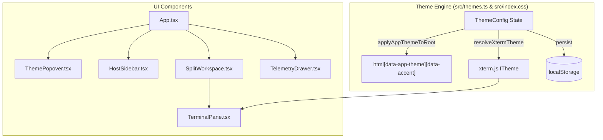

# Theme System & UI/UX Animation Implementation Plan

> **For agentic workers:** Steps use checkbox (`- [ ]`) syntax for tracking.

**Goal:** Implement a 2-layer theming system (shadcn/ui Base App Theme + Classic Terminal Presets featuring Monokai Pro) and smooth hardware-accelerated UI/UX animations across SSH-Box.

**Architecture:** Tailwind CSS v4 `@theme inline` maps semantic shadcn CSS variables (`--background`, `--foreground`, `--card`, `--popover`, `--secondary`, `--muted`, `--border`, `--primary`, `--ring`) defined on `:root` attributes (`data-app-theme`, `data-accent`). Terminal instances dynamically update `term.options.theme`, `fontSize`, and `cursorStyle` via React effects without unmounting active PTY/SSH sessions.

**Architecture Diagram:**

**Tech Stack:** React 18, TypeScript, Tailwind CSS v4, xterm.js v5, Lucide React.

---

### Task 1: Root Metadata, shadcn Semantic Tokens & Animation Utilities
**Files:**
- Modify: `index.html`
- Modify: `src/index.css`

- [x] Add `<meta name="color-scheme" content="light dark" />` to `index.html`
- [x] Configure `@theme inline` and shadcn CSS variables for 5 base themes (`zinc-dark`, `obsidian-dark`, `stone-dark`, `midnight-dark`, `zinc-light`) and 6 accents (`cyan`, `emerald`, `violet`, `amber`, `rose`, `monokai`) in `src/index.css`
- [x] Add `@starting-style` entry animations and `@media (prefers-reduced-motion: reduce)` handling in `src/index.css`

### Task 2: Theme Presets Engine (`src/themes.ts`)
**Files:**
- Create: `src/themes.ts`

- [x] Define `AppThemeId`, `AccentColorId`, `TerminalPresetId`, and `ThemeConfig`
- [x] Implement 8 classic terminal presets (`monokai`, `tokyo-night`, `catppuccin-mocha`, `dracula`, `one-dark`, `nord`, `obsidian`, `solarized-light`)
- [x] Implement `loadThemeConfig`, `saveThemeConfig`, `applyAppThemeToRoot`, and `resolveXtermTheme`

### Task 3: shadcn Theme Customizer Popover (`src/components/ThemePopover.tsx`)
**Files:**
- Create: `src/components/ThemePopover.tsx`

- [x] Build interactive popover with Base UI cards, Accent color swatches, Terminal Preset cards with ANSI color dots, "Match App Background" switch, Font Size stepper, and Cursor Style segmented control

### Task 4: Apply Themes & Smooth Animations to Workspace Components
**Files:**
- Modify: `src/components/TerminalPane.tsx`
- Modify: `src/components/SplitWorkspace.tsx`
- Modify: `src/components/HostSidebar.tsx`
- Modify: `src/components/TelemetryDrawer.tsx`
- Modify: `src/App.tsx`

- [x] Connect `TerminalPane.tsx` to `ThemeConfig` for live updates of `theme`, `fontSize`, and `cursorStyle` + animated status banner
- [x] Upgrade `SplitWorkspace.tsx` with shadcn-styled `ResizableHandle` grip indicator
- [x] Upgrade `HostSidebar.tsx` with collapsible groups, shadcn tokens, and animated modal
- [x] Upgrade `TelemetryDrawer.tsx` with theme-aware sparklines and smooth progress animations
- [x] Upgrade `App.tsx` with animated collapsible drawers (`HostSidebar` & `TelemetryDrawer`), `ThemePopover` integration, and `Cmd+,` shortcut

### Task 5: Verification
- [x] Run `npm run build` (`tsc && vite build`) to verify zero TypeScript or CSS build errors
