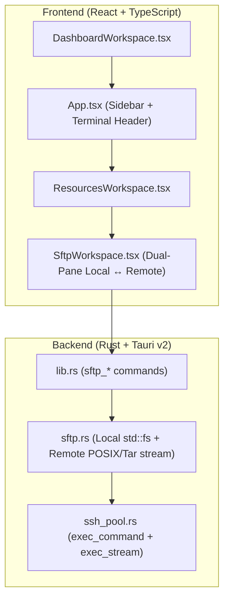

# SFTP Dual-Pane File Manager Implementation Plan

**Goal:** Bổ sung trình quản lý file SFTP 2 cột (Local ↔ Remote) vào `ssh-box` hỗ trợ duyệt thư mục, tìm kiếm, ẩn/hiện dotfiles, truyền file/thư mục 2 chiều, tạo mới, đổi tên, xóa, phân quyền (`chmod`), và sửa nhanh file văn bản.

**Architecture:** Tận dụng kết nối SSH Multiplexed sẵn có trong `SshPool` (`src-tauri/src/ssh_pool.rs`) để truyền luồng dữ liệu nhị phân (`exec_with_io`) và thực thi thao tác file từ xa trong module mới `src-tauri/src/sftp.rs`. Phía Frontend bổ sung `src/components/SftpWorkspace.tsx` được nhúng vào `ResourcesWorkspace` (tab `"sftp"`) và gắn nút mở nhanh từ Sidebar, thẻ Machine, Dashboard và Terminal.

**Architecture Diagram:**

**Tech Stack:** Rust (`std::fs`, `russh`, `tokio`, `serde`), React 19, TypeScript, Tailwind CSS, Lucide Icons.

---

### Task 1: Mở rộng `SshPool` hỗ trợ truyền dữ liệu nhị phân (`exec_bytes` & `upload_bytes`)

**Files:**
- Modify: `src-tauri/src/ssh_pool.rs`

- [x] Thêm phương thức `exec_bytes(host, command, stdin_data)` vào `SshPool` để vừa gửi luồng byte đầu vào (`channel.data` + `channel.eof`), vừa thu nhận mảng byte đầu ra (`Vec<u8>`) phục vụ truyền file/thư mục nhị phân và ghi nội dung file an toàn.

### Task 2: Xây dựng module `src-tauri/src/sftp.rs` kèm Unit Tests

**Files:**
- Create: `src-tauri/src/sftp.rs`
- Modify: `src-tauri/src/lib.rs`

- [x] Định nghĩa `SftpEntry` và `SftpListResponse`.
- [x] Triển khai các hàm cho cả `"local"` (`std::fs`) và máy chủ SSH từ xa (`SshPool`):
  - `list_dir(pool, host_id, path)`
  - `mkdir(pool, host_id, path)`
  - `rename(pool, host_id, old_path, new_path)`
  - `delete(pool, host_id, path)`
  - `chmod(pool, host_id, path, mode)`
  - `read_text(pool, host_id, path)`
  - `write_text(pool, host_id, path, content)`
  - `transfer(pool, source_host_id, source_path, target_host_id, target_dir)`
- [x] Viết unit tests trong `sftp::tests` kiểm tra parser danh sách file từ xa, escape chuỗi POSIX, và các thao tác thư mục Local (`list`, `mkdir`, `write_text`, `read_text`, `chmod`, `rename`, `delete`).
- [x] Đăng ký các Tauri commands vào `src-tauri/src/lib.rs`.

### Task 3: Xây dựng giao diện `SftpWorkspace.tsx` và tích hợp toàn ứng dụng

**Files:**
- Modify: `src/types.ts`
- Create: `src/components/SftpWorkspace.tsx`
- Modify: `src/components/ResourcesWorkspace.tsx`
- Modify: `src/components/DashboardWorkspace.tsx`
- Modify: `src/App.tsx`

- [x] Thêm `"sftp"` vào `TabResources` và định nghĩa `SftpEntry`, `SftpListResponse` trong `src/types.ts`.
- [x] Tạo `src/components/SftpWorkspace.tsx` với giao diện 2 cột Local ↔ Remote, bảng dữ liệu ngữ nghĩa (`scope="col"`, sticky header, `tabular-nums`), thanh đường dẫn, bộ lọc, bật/tắt dotfiles, truyền file/thư mục 2 chiều, tạo file/thư mục, đổi tên, xóa, sửa văn bản và `chmod`.
- [x] Thêm trường `Default SFTP Path` vào modal tạo/sửa Machine và nút mở nhanh **SFTP** trên thẻ Machine, Dashboard, Sidebar Toolbox, và thanh công cụ Terminal.
