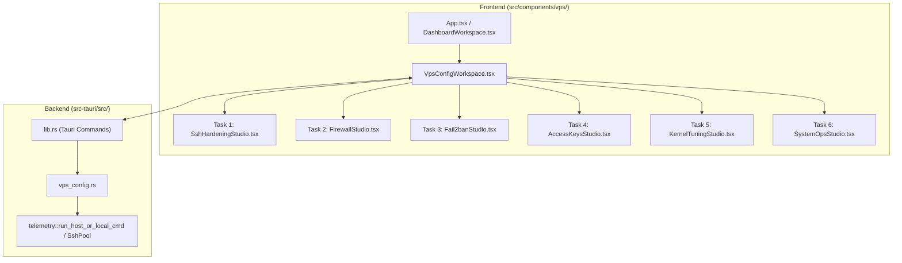

# VPS Server Center & 6 Studios Implementation Plan

> **For agentic workers:** REQUIRED SUB-SKILL: Use superpowers:subagent-driven-development to implement this plan task-by-task. Steps use checkbox (`- [ ]`) syntax for tracking.

**Goal:** Build the complete **VPS Server Center (`VpsConfigWorkspace`)** with 6 purpose-designed UI/UX Studios (SSH Hardening, Firewall & Socket Radar, Fail2ban & Auth Timeline, Access & Keyring Matrix, Kernel & Network Tuning, and System Operations), executing each Studio in its own fresh subagent session.

**Architecture:**
- **Backend (`src-tauri/src/vps_config.rs` + `src-tauri/src/lib.rs`):** A modular Rust module executing privileged shell probes and configuration mutations over `SshPool` (`telemetry::run_host_or_local_cmd`), with pure parser/generator functions covered by `cargo test` unit tests.
- **Frontend (`src/components/VpsConfigWorkspace.tsx` + `src/components/vps/*Studio.tsx`):** A dedicated Server Center shell reachable from the main left sidebar (`TabResources = "vpsConfig"`), Dashboard host cards, and Terminal toolbar, containing 6 bespoke React 19 + Tailwind v4 Studios following `modern-web-guidance` (`switch` and `responsive-table`).

**Architecture Diagram:**

**Tech Stack:** Rust (`serde`, `tokio`, Tauri v2 IPC), React 19, TypeScript, Tailwind CSS v4, `lucide-react`.

---

### Task 1: Session 1 — Server Center Shell & SSH Daemon Hardening Studio (`SshHardeningStudio`)

**Files:**
- Create: [src-tauri/src/vps_config.rs](file://~/ssh-box/src-tauri/src/vps_config.rs)
- Modify: [src-tauri/src/lib.rs](file://~/ssh-box/src-tauri/src/lib.rs)
- Modify: [src/types.ts](file://~/ssh-box/src/types.ts)
- Modify: [src/i18n.ts](file://~/ssh-box/src/i18n.ts)
- Modify: [src/index.css](file://~/ssh-box/src/index.css)
- Create: [src/components/vps/SshHardeningStudio.tsx](file://~/ssh-box/src/components/vps/SshHardeningStudio.tsx)
- Create: [src/components/VpsConfigWorkspace.tsx](file://~/ssh-box/src/components/VpsConfigWorkspace.tsx)
- Modify: [src/App.tsx](file://~/ssh-box/src/App.tsx)
- Modify: [src/components/DashboardWorkspace.tsx](file://~/ssh-box/src/components/DashboardWorkspace.tsx)

- [ ] **Step 1: Create `src-tauri/src/vps_config.rs` with privileged runner, SSH config parser, posture scorer, diff generator, and unit tests**
  - Implement `VpsPrivilegeInfo` (`user`, `uid`, `is_root`, `passwordless_sudo`, `os_pretty_name`, `detected_client_ip`).
  - Implement `run_privileged_script(host_id, pool, sudo_password, script)` that runs directly if `id -u == 0`, via `sudo -n sh -c` if passwordless sudo is available, or via `sudo -S -p '' sh -c` using `sudo_password` or the host's stored secret from `vault` / `resources`.
  - Implement `SshdConfigSnapshot` (`port: u16`, `permit_root_login: String`, `password_authentication: bool`, `pubkey_authentication: bool`, `permit_empty_passwords: bool`, `max_auth_tries: u32`, `login_grace_time: u32`, `client_alive_interval: u32`, `client_alive_count_max: u32`, `allow_users: Vec<String>`, `x11_forwarding: bool`, `allow_tcp_forwarding: bool`, `allow_agent_forwarding: bool`, `address_family: String`, `authorized_keys_count: u32`, `security_score: u32`, `raw_config: String`, `rollback_pending: bool`).
  - Implement `parse_sshd_config(raw: &str, authorized_keys_count: u32, rollback_pending: bool) -> SshdConfigSnapshot`, `compute_ssh_security_score(&SshdConfigSnapshot) -> u32`, and `render_sshd_config(base_raw: &str, desired: &SshdConfigUpdate) -> String`.
  - Implement Tauri commands in `lib.rs`:
    - `vps_probe_privilege(host_id, sudo_password)`
    - `vps_get_sshd_config(host_id, sudo_password)`
    - `vps_apply_sshd_config(host_id, update, sudo_password, with_auto_rollback)` (validates with `sshd -t -f`, backs up `/etc/ssh/sshd_config.sshbox.bak`, opens new port in `ufw` if active, starts 30s rollback timer in `/tmp/sshbox-sshd-rollback.pid` if `with_auto_rollback` is true, and reloads `sshd`)
    - `vps_confirm_sshd_config(host_id, sudo_password)` (kills `/tmp/sshbox-sshd-rollback.pid` so changes become permanent)
    - `vps_revert_sshd_config(host_id, sudo_password)` (immediately restores `/etc/ssh/sshd_config.sshbox.bak` and reloads `sshd`)

- [ ] **Step 2: Run Rust unit tests for `vps_config` SSH parser, scorer, and config renderer**
  - Run: `cargo test --manifest-path src-tauri/Cargo.toml vps_config`
  - Expected: PASS

- [ ] **Step 3: Build bespoke UI/UX for `VpsConfigWorkspace.tsx` shell and `SshHardeningStudio.tsx`**
  - Add `"vpsConfig"` to `TabResources` in `src/types.ts` and `navVpsConfig` in `src/i18n.ts`.
  - Add modern web guidance CSS utilities in `src/index.css` (`input[type="checkbox"][switch]` styling + `.vps-table-region` with `@container` and `position: sticky` headers).
  - Build `src/components/VpsConfigWorkspace.tsx` with:
    - Machine Selector + Host IP/Port pill + OS badge
    - Live Privilege Badge (`ROOT` emerald, `SUDO NOPASSWD` cyan, `SUDO LOCKED` amber with inline password unlock popover)
    - 6 Studio Switcher Tabs with icons and status pills
  - Build `src/components/vps/SshHardeningStudio.tsx` with:
    - **Zone A:** Circular Security Posture Gauge (`0–100`) + Hardening Checklist + 1-Click Presets (*Key-Only Fortress*, *Balanced Production*, *Reset*)
    - **Zone B:** Network & Listening Port Card (with random high-port generator `20000–60000` & port-change firewall notice), Authentication Gate Card (segmented `PermitRootLogin` selector, `<input type="checkbox" switch>` toggles, and Lockout Guard Alert when disabling `PasswordAuthentication` with `0` authorized keys), and Session & Access Control Card (`AllowUsers` chip editor, steppers for `MaxAuthTries`, `LoginGraceTime`, `ClientAliveInterval`, forwarding switches)
    - **Zone C:** Live `sshd_config` Unified Diff Inspector (highlighting removed lines in rose and added/updated directives in emerald) + **30-Second Anti-Lockout Countdown Modal** that auto-updates `HostEntry.port` via `onSaveHost` upon confirmation.
  - Wire `VpsConfigWorkspace` into `src/App.tsx` and add quick-open button on host cards in `src/components/DashboardWorkspace.tsx`.

- [ ] **Step 4: Verify frontend build & tests, then commit Session 1**
  - Run: `npm run build && cargo test --manifest-path src-tauri/Cargo.toml`
  - Commit: `feat(vps): add Server Center shell and SSH Hardening Studio with 30s anti-lockout`

---

### Task 2: Session 2 — Firewall & Live Listening Socket Radar (`FirewallStudio`)

**Files:**
- Modify: [src-tauri/src/vps_config.rs](file://~/ssh-box/src-tauri/src/vps_config.rs)
- Modify: [src-tauri/src/lib.rs](file://~/ssh-box/src-tauri/src/lib.rs)
- Modify: [src/types.ts](file://~/ssh-box/src/types.ts)
- Create: [src/components/vps/FirewallStudio.tsx](file://~/ssh-box/src/components/vps/FirewallStudio.tsx)
- Modify: [src/components/VpsConfigWorkspace.tsx](file://~/ssh-box/src/components/VpsConfigWorkspace.tsx)

- [ ] **Step 1: Add Firewall & Listening Socket parser/commands in `src-tauri/src/vps_config.rs` with unit tests**
  - Implement `ListeningSocketItem` (`protocol`, `bind_addr`, `port`, `is_public`, `process_name`, `pid`, `exposure`: `"exposed" | "restricted" | "blocked" | "loopback"`).
  - Implement `FirewallRuleItem` (`index`, `to_port`, `protocol`, `action`, `from_source`, `v6`, `comment`).
  - Implement `FirewallSnapshot` (`engine`: `"ufw" | "iptables" | "firewalld" | "none"`, `enabled: bool`, `default_incoming: String`, `default_outgoing: String`, `detected_client_ip: String`, `rules: Vec<FirewallRuleItem>`, `listening_sockets: Vec<ListeningSocketItem>`).
  - Implement `parse_firewall_snapshot(raw: &str) -> FirewallSnapshot` (parsing `ufw status numbered`, `iptables -S`, and `ss -tulpn` output and correlating each listening port's exposure status).
  - Add Tauri commands:
    - `vps_get_firewall_snapshot(host_id, sudo_password)`
    - `vps_add_firewall_rule(host_id, action, port_spec, proto, source_ip, comment, sudo_password)`
    - `vps_delete_firewall_rule(host_id, rule_index, rule_spec, sudo_password)`
    - `vps_set_firewall_state(host_id, enabled, default_incoming, sudo_password)` (always ensures current SSH port is allowed before enabling `ufw`!)

- [ ] **Step 2: Run Rust unit tests for `parse_firewall_snapshot`**
  - Run: `cargo test --manifest-path src-tauri/Cargo.toml firewall`
  - Expected: PASS

- [ ] **Step 3: Build bespoke UI/UX for `FirewallStudio.tsx` and wire into `VpsConfigWorkspace.tsx`**
  - **Top Command Banner:** Engine badge (`UFW` / `iptables`), Master Firewall Switch (with anti-lockout SSH port guarantee), Default Policy pills, and **Client IP Shield Banner** with 1-click **"Whitelist My IP (`x.x.x.x`)"** button.
  - **Left Split Pane — Live Listening Socket Radar (`ss -tulpn`):**
    - Visual cards/rows showing every active listening port on the VPS, Bind Scope badge (`0.0.0.0 Public` vs `127.0.0.1 Loopback`), Process/PID (`nginx #1234`), live Firewall Exposure status badge, and 1-click **"Allow Public"**, **"Allow My IP Only"**, or **"Block Port"** actions directly on each socket.
  - **Right Split Pane — Visual Firewall Rule Composer & Sticky-Header Rule Matrix:**
    - 1-Click Service Presets (*Web 80/443*, *SSH Rate-Limit*, *PostgreSQL 5432 from My IP*, *Redis 6379 Block Public*) + custom rule composer (`ALLOW`/`LIMIT`/`DENY`, Port/Range, Protocol, Source CIDR) + responsive sticky-header rule table (`role="region"`).

- [ ] **Step 4: Verify build & tests, then commit Session 2**
  - Run: `npm run build && cargo test --manifest-path src-tauri/Cargo.toml`
  - Commit: `feat(vps): add Firewall Studio with live ss -tulpn socket radar and IP rule matrix`

---

### Task 3: Session 3 — Intrusion Prevention & Auth Audit Timeline (`Fail2banStudio`)

**Files:**
- Modify: [src-tauri/src/vps_config.rs](file://~/ssh-box/src-tauri/src/vps_config.rs)
- Modify: [src-tauri/src/lib.rs](file://~/ssh-box/src-tauri/src/lib.rs)
- Modify: [src/types.ts](file://~/ssh-box/src/types.ts)
- Create: [src/components/vps/Fail2banStudio.tsx](file://~/ssh-box/src/components/vps/Fail2banStudio.tsx)
- Modify: [src/components/VpsConfigWorkspace.tsx](file://~/ssh-box/src/components/VpsConfigWorkspace.tsx)

- [ ] **Step 1: Add Fail2ban & SSH Auth Audit parser/commands in `src-tauri/src/vps_config.rs` with unit tests**
  - Implement `Fail2banJailItem` (`name`, `currently_failed`, `total_failed`, `currently_banned`, `total_banned`, `banned_ips: Vec<String>`, `findtime_secs: u32`, `bantime_secs: i64`, `maxretry: u32`).
  - Implement `SshAuthAuditEvent` (`timestamp`, `event_type`: `"accepted" | "failed" | "invalid_user"`, `username`, `ip`, `method`, `port`, `raw_line`).
  - Implement `Fail2banSnapshot` (`installed: bool`, `running: bool`, `jails: Vec<Fail2banJailItem>`, `ignore_ips: Vec<String>`, `auth_events: Vec<SshAuthAuditEvent>`, `top_attacker_ips: Vec<(String, u32)>`).
  - Implement `parse_fail2ban_and_auth_snapshot(raw: &str) -> Fail2banSnapshot` with unit tests covering `fail2ban-client status <jail>` and `/var/log/auth.log` / `journalctl` lines.
  - Add Tauri commands:
    - `vps_get_fail2ban_snapshot(host_id, sudo_password)`
    - `vps_fail2ban_ban_action(host_id, jail, ip, action, sudo_password)` (`"ban"` or `"unban"`)
    - `vps_update_fail2ban_jail(host_id, maxretry, findtime_secs, bantime_secs, ignore_ips, sudo_password)` (writes `/etc/fail2ban/jail.d/99-sshbox.local` and reloads `fail2ban`)
    - `vps_install_fail2ban(host_id, sudo_password)` (1-click install via `apt-get`/`dnf`/`yum` + enables `sshd` jail)

- [ ] **Step 2: Run Rust unit tests for Fail2ban & Auth log parsers**
  - Run: `cargo test --manifest-path src-tauri/Cargo.toml fail2ban`
  - Expected: PASS

- [ ] **Step 3: Build bespoke UI/UX for `Fail2banStudio.tsx` and wire into `VpsConfigWorkspace.tsx`**
  - **Zero-State Onboarding Card:** If `fail2ban` is not installed, renders a 1-click **"Install & Activate Fail2ban SSH Protection"** hero card.
  - **Top Deck — Jail Health Cards & Policy Tuner:** Visual cards per jail (`sshd`, etc.) + interactive policy drawer/card for `maxretry`, `findtime`, `bantime`, and `ignoreip` whitelist (with 1-click *"Add My IP to Ignore List"*).
  - **Left Pane — Active Quarantine Vault & Top Attackers Radar:**
    - Searchable list of currently banned IPs with 1-click **Unban**, manual **Ban IP** input, and **Top Attacking IPs** frequency bar chart.
  - **Right Pane — Live SSH Authentication Audit Timeline:**
    - Segmented filter (*All Events*, *Accepted Logins*, *Brute-Force Failures*) rendering a visual timeline with method badges (`publickey` vs `password`), user/IP pills, and a 1-click **"Ban IP"** button right on any failed login event.

- [ ] **Step 4: Verify build & tests, then commit Session 3**
  - Run: `npm run build && cargo test --manifest-path src-tauri/Cargo.toml`
  - Commit: `feat(vps): add Fail2ban Studio with quarantine vault and SSH auth audit timeline`

---

### Task 4: Session 4 — Linux Users, Sudoers & Keyring Matrix (`AccessKeysStudio`)

**Files:**
- Modify: [src-tauri/src/vps_config.rs](file://~/ssh-box/src-tauri/src/vps_config.rs)
- Modify: [src-tauri/src/lib.rs](file://~/ssh-box/src-tauri/src/lib.rs)
- Modify: [src/types.ts](file://~/ssh-box/src/types.ts)
- Create: [src/components/vps/AccessKeysStudio.tsx](file://~/ssh-box/src/components/vps/AccessKeysStudio.tsx)
- Modify: [src/components/VpsConfigWorkspace.tsx](file://~/ssh-box/src/components/VpsConfigWorkspace.tsx)

- [ ] **Step 1: Add Linux Accounts, Sudoers, and Authorized Keys parser/commands in `src-tauri/src/vps_config.rs` with unit tests**
  - Implement `RemoteAuthorizedKey` (`index`, `key_type`, `public_key_body`, `comment`, `raw_line`, `short_preview`).
  - Implement `LinuxAccountItem` (`username`, `uid`, `gid`, `home_dir`, `shell`, `locked: bool`, `groups: Vec<String>`, `has_sudo: bool`, `nopasswd_sudo: bool`, `authorized_keys: Vec<RemoteAuthorizedKey>`).
  - Implement `AccessKeysSnapshot` (`accounts: Vec<LinuxAccountItem>`).
  - Implement `parse_access_keys_snapshot(raw: &str) -> AccessKeysSnapshot` with unit tests.
  - Add Tauri commands:
    - `vps_get_access_keys_snapshot(host_id, sudo_password)`
    - `vps_authorize_ssh_key(host_id, username, public_key, sudo_password)` (creates `<home>/.ssh` `0700`, appends key if not duplicate to `authorized_keys` `0600`, `chown -R <user>:<user>`)
    - `vps_revoke_ssh_key(host_id, username, key_body, sudo_password)`
    - `vps_create_linux_user(host_id, username, shell, sudo_access, nopasswd_sudo, docker_access, initial_public_key, sudo_password)`
    - `vps_update_linux_user_privilege(host_id, username, nopasswd_sudo, locked, sudo_password)` (writes/removes `/etc/sudoers.d/90-sshbox-<user>` validated with `visudo -cf` and locks/unlocks via `usermod -L/-U`)

- [ ] **Step 2: Run Rust unit tests for `parse_access_keys_snapshot`**
  - Run: `cargo test --manifest-path src-tauri/Cargo.toml access_keys`
  - Expected: PASS

- [ ] **Step 3: Build bespoke UI/UX for `AccessKeysStudio.tsx` and wire into `VpsConfigWorkspace.tsx`**
  - **Left Column — Linux Accounts Deck & "+ Create Account" Modal:**
    - Account cards for `root` and human/deploy users (`UID >= 1000`) displaying UID, shell, group badges (`sudo`, `docker`), `NOPASSWD` switch, Account Lock switch, and key count pill.
  - **Right Column — Visual Keyring Matrix & `ssh-box` Local Keychain Bridge:**
    - **Authorized Keys on `<user>`:** Structured key cards showing key algorithm (`ED25519` / `RSA`), comment, key fingerprint/preview, a green **"Matched in ssh-box Vault"** badge when cross-referenced against `resources.sshKeys`, and 1-click **Revoke**.
    - **`ssh-box` Keychain Bridge Deck:** Displays all keys from `resources.sshKeys` with a 1-click **"Authorize on `<user>`"** button (or `Authorized ✓` pill if already present) plus an inline **"+ Paste External Public Key"** drawer.

- [ ] **Step 4: Verify build & tests, then commit Session 4**
  - Run: `npm run build && cargo test --manifest-path src-tauri/Cargo.toml`
  - Commit: `feat(vps): add Access & Keyring Matrix Studio with local keychain bridge and sudoers manager`

---

### Task 5: Session 5 — Kernel & Network Tuning Deck (`KernelTuningStudio`)

**Files:**
- Modify: [src-tauri/src/vps_config.rs](file://~/ssh-box/src-tauri/src/vps_config.rs)
- Modify: [src-tauri/src/lib.rs](file://~/ssh-box/src-tauri/src/lib.rs)
- Modify: [src/types.ts](file://~/ssh-box/src/types.ts)
- Create: [src/components/vps/KernelTuningStudio.tsx](file://~/ssh-box/src/components/vps/KernelTuningStudio.tsx)
- Modify: [src/components/VpsConfigWorkspace.tsx](file://~/ssh-box/src/components/VpsConfigWorkspace.tsx)

- [ ] **Step 1: Add Kernel & Sysctl parser/commands in `src-tauri/src/vps_config.rs` with unit tests**
  - Implement `KernelSysctlSnapshot` (`kernel_release`, `bbr_supported: bool`, `bbr_active: bool`, `congestion_control`, `default_qdisc`, `swappiness: u32`, `overcommit_memory: u32`, `file_max: u64`, `somaxconn: u32`, `tcp_max_syn_backlog: u32`, `tcp_tw_reuse: bool`, `tcp_syncookies: bool`, `icmp_echo_ignore_all: bool`, `rp_filter: bool`, `accept_redirects: bool`, `ip_forward: bool`).
  - Implement `parse_kernel_sysctl_snapshot(raw: &str) -> KernelSysctlSnapshot` and `render_sysctl_conf(params: &[(String, String)]) -> String` with unit tests.
  - Add Tauri commands:
    - `vps_get_kernel_snapshot(host_id, sudo_password)`
    - `vps_apply_kernel_tuning(host_id, updates, sudo_password)` (writes `/etc/sysctl.d/99-sshbox.conf` and applies immediately via `sysctl -p /etc/sysctl.d/99-sshbox.conf`)

- [ ] **Step 2: Run Rust unit tests for `parse_kernel_sysctl_snapshot` and `render_sysctl_conf`**
  - Run: `cargo test --manifest-path src-tauri/Cargo.toml kernel`
  - Expected: PASS

- [ ] **Step 3: Build bespoke UI/UX for `KernelTuningStudio.tsx` and wire into `VpsConfigWorkspace.tsx`**
  - **Top Deck — 3 Signature Profile Cards:**
    - **Google TCP BBR Accelerator Card:** Shows live kernel congestion control (`bbr` vs `cubic`) + `default_qdisc` (`fq`) with 1-click **"Enable TCP BBR"** toggle.
    - **High-Concurrency Server Profile Card:** 1-click preset tuning `fs.file-max`, `net.core.somaxconn`, `net.ipv4.tcp_max_syn_backlog`, and `net.ipv4.tcp_tw_reuse`.
    - **Kernel Network Fortress Card:** 1-click preset enabling SYN flood cookies, reverse-path filtering, disabling ICMP redirects, plus a dedicated **"Ping Stealth Mode (`icmp_echo_ignore_all`)"** switch.
  - **Bottom Deck — Visual Sysctl Gauges & Range Sliders:**
    - Interactive cards for Memory (`vm.swappiness` slider `0–100` with visual RAM-vs-Swap ratio bar, `vm.overcommit_memory`), Network (`net.core.somaxconn`, `net.ipv4.tcp_max_syn_backlog`, `net.ipv4.ip_forward`), and Filesystem (`fs.file-max`), showing **Current Value** vs **Staged Value** vs **Recommended Target** and a live `/etc/sysctl.d/99-sshbox.conf` preview.

- [ ] **Step 4: Verify build & tests, then commit Session 5**
  - Run: `npm run build && cargo test --manifest-path src-tauri/Cargo.toml`
  - Commit: `feat(vps): add Kernel & Network Tuning Studio with TCP BBR and sysctl gauges`

---

### Task 6: Session 6 — System Operations Studio: Dynamic Swap, Systemd & Cron (`SystemOpsStudio`)

**Files:**
- Modify: [src-tauri/src/vps_config.rs](file://~/ssh-box/src-tauri/src/vps_config.rs)
- Modify: [src-tauri/src/lib.rs](file://~/ssh-box/src-tauri/src/lib.rs)
- Modify: [src/types.ts](file://~/ssh-box/src/types.ts)
- Create: [src/components/vps/SystemOpsStudio.tsx](file://~/ssh-box/src/components/vps/SystemOpsStudio.tsx)
- Modify: [src/components/VpsConfigWorkspace.tsx](file://~/ssh-box/src/components/VpsConfigWorkspace.tsx)

- [ ] **Step 1: Add Swap, Systemd Services, Cron, and Host Identity parser/commands in `src-tauri/src/vps_config.rs` with unit tests**
  - Implement `SwapFileItem` (`filename`, `swap_type`, `size_mb: u64`, `used_mb: u64`, `priority: i32`).
  - Implement `SystemdServiceItem` (`unit`, `load_state`, `active_state`, `sub_state`, `description`, `enabled: bool`).
  - Implement `CronJobItem` (`index`, `schedule`, `command`, `paused: bool`, `raw_line`).
  - Implement `SystemOpsSnapshot` (`hostname`, `timezone`, `dns_servers: Vec<String>`, `ram_total_mb: u64`, `ram_used_mb: u64`, `disk_free_mb: u64`, `swap_total_mb: u64`, `swap_used_mb: u64`, `swaps: Vec<SwapFileItem>`, `services: Vec<SystemdServiceItem>`, `cron_jobs: Vec<CronJobItem>`).
  - Implement `parse_system_ops_snapshot(raw: &str) -> SystemOpsSnapshot` with unit tests.
  - Add Tauri commands:
    - `vps_get_system_ops_snapshot(host_id, sudo_password)`
    - `vps_configure_swapfile(host_id, size_mb, sudo_password)` (`0` disables & removes `/swapfile` from `/etc/fstab`; `>0` creates `/swapfile` via `fallocate`/`dd`, `chmod 600`, `mkswap`, `swapon`, and persists in `/etc/fstab`)
    - `vps_systemd_action(host_id, unit, action, sudo_password)` (`"start" | "stop" | "restart" | "enable" | "disable"`)
    - `vps_systemd_logs(host_id, unit, lines, sudo_password)` (`journalctl -u <unit> -n <lines> --no-pager`)
    - `vps_save_cron_jobs(host_id, jobs, sudo_password)`
    - `vps_update_host_identity(host_id, hostname, timezone, dns_servers, sudo_password)`

- [ ] **Step 2: Run Rust unit tests for `parse_system_ops_snapshot`**
  - Run: `cargo test --manifest-path src-tauri/Cargo.toml system_ops`
  - Expected: PASS

- [ ] **Step 3: Build bespoke UI/UX for `SystemOpsStudio.tsx` and wire into `VpsConfigWorkspace.tsx`**
  - **Section A — Dynamic Swap Allocator & Host Identity Deck:**
    - Visual stacked capacity bar comparing Physical RAM, Active Swap, and Free Disk Space, paired with 1-click Swap Allocator pills (`Off`, `512 MB`, `1 GB`, `2 GB`, `4 GB`, `8 GB`).
    - Host Identity bar for editing `hostname`, `timezone`, and 1-click DNS Resolver presets (*Cloudflare 1.1.1.1*, *Google 8.8.8.8*, *Quad9 9.9.9.9*).
  - **Section B — Systemd Service Deck + Live `journalctl` Drawer:**
    - Searchable, sticky-header service table (`role="region"`) with filter pills (*All*, *Running*, *Failed*, *Core Services*), 1-click `Start`/`Stop`/`Restart`/`Enable`, and slide-over live `journalctl` log viewer.
  - **Section C — Human-Readable Cron Studio:**
    - Visual 5-field cron builder with preset chips and a real-time **Human-Readable Schedule Translator** (e.g., `"*/5 * * * *"` → *"Runs every 5 minutes"*, `"0 2 * * *"` → *"Runs daily at 02:00"*), plus active cron job cards with Pause/Resume switch and Delete.

- [ ] **Step 4: Verify full build & test suite, then commit Session 6**
  - Run: `npm run build && cargo test --manifest-path src-tauri/Cargo.toml`
  - Commit: `feat(vps): add System Operations Studio with dynamic swap allocator, systemd deck, and visual cron studio`
