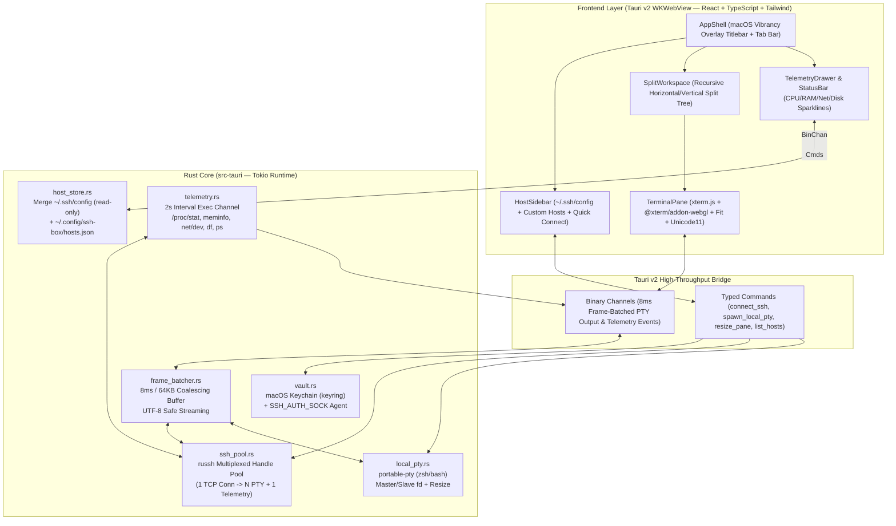

# SSH-Box — Tài liệu Thiết kế Kỹ thuật (Giai đoạn 1 MVP)

**Ngày:** 2026-10-22  
**Dự án:** `ssh-box` (`~/ssh-box`)  
**Mục tiêu:** Xây dựng ứng dụng quản lý Server & Terminal tích hợp trên macOS bằng **Rust + Tauri v2 + WebGL2**, lấy cảm hứng từ `/Applications/Server Box.app` (`com.lollipopkit.toolbox`) nhưng loại bỏ hoàn toàn độ trễ của Flutter/Dart terminal, mang lại trải nghiệm Terminal mượt 120fps như **iTerm2** và giao diện hiện đại như **Termius**.

---

## 1. Bối cảnh & Phân tích Đối chiếu (`Server Box.app` vs `SSH-Box`)

Qua phân tích gói `/Applications/Server Box.app` (v1.0.1787, `arm64`) bằng bộ công cụ `rea`:
- **Hiện trạng của `Server Box.app` (`ev_bd15597c...`, `ev_46cc18b6...`):**
  - Sử dụng `FlutterMacOS.framework` + `xterm.dart` + `dartssh2`.
  - Việc giải mã chuỗi ANSI/VT100 và vẽ từng ô chữ thông qua cây Widget/Canvas của Flutter trên luồng UI chính khiến tốc độ khung hình sụt giảm khi chạy `btop`, `htop`, `tmux`, `nvim` hoặc xả log lớn, đồng thời việc xử lý bộ gõ tiếng Việt (IME) và chia khung (Split Panes) thiếu tự nhiên.
- **Giải pháp của `SSH-Box`:**
  - Tách toàn bộ tầng mạng SSH (`russh`), Local PTY (`portable-pty`), đọc `~/.ssh/config`, macOS Keychain (`keyring`) và thu thập thông số Server (`TelemetryPoller`) xuống **Rust Async Core (`tokio`)**.
  - Truyền dữ liệu terminal theo cơ chế **Frame-Batched Binary Streaming (`8ms` / 120Hz)** qua `tauri::ipc::Channel` thẳng tới trình vẽ **WebGL2 GPU Glyph Atlas** (`@xterm/addon-webgl`).

---

## 2. Kiến trúc Hệ thống & Phân tách Module



### Ranh giới và Trách nhiệm từng Module trong `src-tauri/src/`

| Module | Trách nhiệm duy nhất | Giao diện (Public API) | Phụ thuộc |
|---|---|---|---|
| `host_store.rs` | Đọc `~/.ssh/config` (chỉ đọc) và hợp nhất với danh sách host do người dùng lưu trong `~/.config/ssh-box/hosts.json`. | `load_all_hosts()`, `upsert_custom_host()`, `delete_custom_host()` | `ssh2-config`, `serde_json`, `dirs` |
| `vault.rs` | Lưu/đọc mật khẩu hoặc passphrase khoá SSH trong **macOS Keychain**; không lưu mật khẩu dạng rõ trên đĩa. | `get_secret(host_id)`, `set_secret(host_id, secret)`, `delete_secret(host_id)` | `keyring` (`apple-native`) |
| `ssh_pool.rs` | Quản lý vòng đời kết nối `russh` theo `host_id` (SSH Multiplexing), mở kênh PTY mới cho từng pane và mở kênh `exec` cho bộ giám sát. | `get_or_connect(host_cfg)`, `open_pty_pane(host_id, cols, rows, channel)`, `exec_command(host_id, cmd)` | `russh`, `russh-keys`, `tokio`, `vault`, `frame_batcher` |
| `local_pty.rs` | Khởi tạo tiến trình shell nội bộ (`$SHELL` / `/bin/zsh`) qua `portable-pty`, hỗ trợ đọc/ghi bất đồng bộ và thay đổi kích thước khung. | `spawn_local_pane(cols, rows, cwd, channel)`, `write_input(pane_id, bytes)`, `resize_pane(pane_id, cols, rows)` | `portable-pty`, `tokio`, `frame_batcher` |
| `frame_batcher.rs` | Gom các mảnh byte xuất ra từ PTY/SSH trong chu kỳ `8ms` (120Hz) hoặc tối đa `64KB`/gói trước khi đẩy lên `tauri::ipc::Channel`. | `spawn_batched_reader(reader, ipc_channel, shutdown_rx)` | `bytes`, `tokio::time` |
| `telemetry.rs` | Chạy tác vụ nền định kỳ `2s`/lần trên kết nối SSH đang mở để lấy và tính delta `%CPU`, `RAM`, `Swap`, `Net RX/TX (B/s)`, `Disk`, `Top Processes`. | `start_monitoring(host_id, ipc_channel)`, `parse_linux_snapshot(raw, prev)` | `ssh_pool`, `serde` |

---

## 3. Luồng Dữ liệu & Giao thức Chi tiết

### 3.1. Đường ống Terminal 120fps (`FrameBatcher`)
1. Khi một pane (SSH hoặc Local PTY) được tạo, Frontend truyền một đối tượng `Channel<Uint8Array>` xuống lệnh Tauri `open_pane`.
2. `frame_batcher.rs` đọc luồng byte thô vào bộ đệm `BytesMut` dung lượng 64KB:
   - Nếu có dữ liệu mới, bộ hẹn giờ `tokio::time::sleep(Duration::from_millis(8))` được kích hoạt.
   - Ngay khi hết `8ms` **hoặc** bộ đệm đạt `64KB`, toàn bộ khối byte được đẩy một lần qua `ipc_channel.send(chunk)`.
   - Ở phía Frontend, `xterm.write(uint8Array)` nhận trực tiếp mảng byte nhị phân (nhờ bộ giải mã UTF-8 có trạng thái tích hợp sẵn của `xterm.js`), sau đó `@xterm/addon-webgl` vẽ thẳng lên GPU.
3. Khi người dùng gõ phím hoặc dán văn bản, `onData` chuyển thành `Uint8Array` và gọi `write_pane_input(pane_id, data)` gửi thẳng xuống luồng ghi của `russh` / `portable-pty` không qua bất kỳ bộ đệm trễ nào.

### 3.2. Chia đôi Màn hình Đệ quy (Recursive Split Panes)
- Cấu trúc dữ liệu mỗi Tab là một cây nhị phân `PaneNode`:
  - `Leaf { paneId, kind: 'ssh' | 'local', hostId?, title, status }`
  - `Split { id, direction: 'horizontal' | 'vertical', ratio: number, first: PaneNode, second: PaneNode }`
- Hỗ trợ phím tắt chuẩn iTerm2:
  - `Cmd+D`: Chia dọc (Vertical Split — mở thêm 1 pane cùng Host hoặc Local shell hiện tại).
  - `Cmd+Shift+D`: Chia ngang (Horizontal Split).
  - `Cmd+W`: Đóng pane hiện tại (tự động thu gọn nút `Split` cha và giải phóng kênh PTY dưới Rust).
  - `Cmd+T`: Mở Tab mới.
  - `Cmd+I`: Bật/tắt ngăn Telemetry Inspector bên phải.

### 3.3. Thu thập Thông số Server (`TelemetryPoller`)
Câu lệnh một dòng chạy qua kênh `exec` (không cấp phát PTY nên không kích hoạt `.bashrc`/MOTD và không ghi vào `.bash_history`):
```sh
LC_ALL=C sh -c 'uname -s; cat /proc/loadavg 2>/dev/null || sysctl -n vm.loadavg; head -n 1 /proc/stat 2>/dev/null; grep -E "^(MemTotal|MemAvailable|SwapTotal|SwapFree):" /proc/meminfo 2>/dev/null; cat /proc/net/dev 2>/dev/null; df -kP / 2>/dev/null | tail -n 1; ps -eo pid,pcpu,pmem,comm --sort=-pcpu 2>/dev/null | head -n 6'
```
- **Tính toán Delta chính xác trong Rust:**
  - `%CPU = 100.0 * (1.0 - (idle_delta / total_jiffies_delta))` giữa 2 lần lấy mẫu liên tiếp.
  - `Net RX/TX (bytes/sec) = (bytes_now - bytes_prev) / elapsed_secs` (bỏ qua giao diện `lo`).

---

## 4. Xử lý Lỗi & Các Trường hợp Biên (Edge Cases)

1. **Mất kết nối mạng / Server đóng kết nối:**
   - `russh` bật `keepalive_interval = Some(Duration::from_secs(15))`.
   - Khi kênh SSH đóng bất ngờ, Rust gửi sự kiện `PaneState::Disconnected { reason }` về đúng `pane_id` đó.
   - Giao diện hiển thị thanh trạng thái ngay trên pane đó với nút **Reconnect (`Enter`)** để khởi tạo lại kênh mà không làm mất lịch sử log đang hiển thị trên màn hình.
2. **Xử lý Host Key (`known_hosts`):**
   - Kiểm tra khoá công khai của server với `~/.ssh/known_hosts`. Nếu là host mới lần đầu kết nối, tự động ghi nhận theo chính sách TOFU (Trust On First Use) kèm hiển thị dấu vân tay SHA-256 trên thanh trạng thái; nếu khoá thay đổi bất thường, từ chối kết nối và cảnh báo rõ ràng.
3. **Dọn dẹp Tài nguyên (Zero Zombie Processes):**
   - Khi đóng một pane hoặc đóng cửa sổ ứng dụng, `Drop` / `close_pane` gửi `SIGHUP` cho tiến trình `portable-pty` nội bộ hoặc gửi `channel.close()` cho kênh `russh`, đồng thời dừng `TelemetryPoller` khi không còn pane nào trỏ tới `host_id` đó.

---

## 5. Kế hoạch Kiểm thử & Xác minh (Verification Strategy)

1. **Unit Tests (`cargo test`):**
   - `host_store::tests`: Kiểm thử parse file `~/.ssh/config` mẫu (có `Host`, `HostName`, `User`, `Port`, `IdentityFile`, wildcard `*` bị lọc bỏ) và gộp với `hosts.json`.
   - `frame_batcher::tests`: Kiểm thử luồng xả 1MB dữ liệu liên tục được gom thành các gói $\le 64\text{KB}$ và bảo toàn 100% chuỗi byte đầu ra.
   - `telemetry::tests`: Kiểm thử parser `/proc/stat`, `/proc/meminfo`, `/proc/net/dev`, `df`, `ps` trên dữ liệu mẫu Linux và tính đúng `%CPU` delta cũng như tốc độ mạng `RX/TX`.
2. **Integration Tests (`cargo test`):**
   - Khởi chạy một phiên Local PTY (`portable-pty` với `/bin/sh`), gửi lệnh `echo "hello-ssh-box"`, xác nhận nhận đủ dữ liệu qua `FrameBatcher`, resize khung từ `80x24` sang `120x40`, và đóng phiên sạch sẽ.
