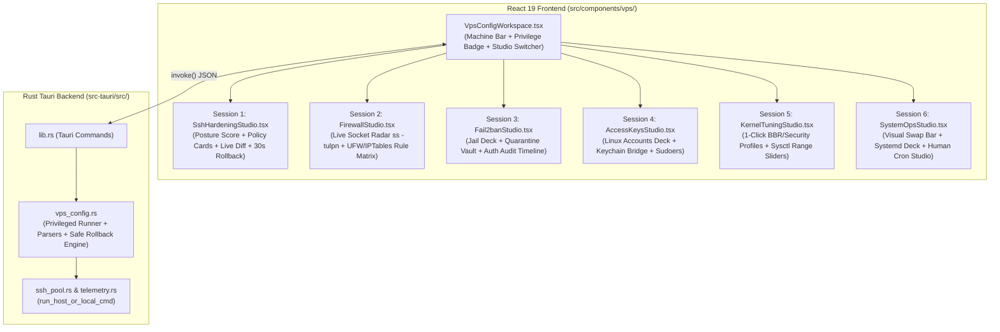

# VPS Server Center & 6 Advanced Configuration Studios — Design Specification

**Date:** 2026-10-30  
**Project:** `ssh-box` (Tauri v2 + React 19 + TypeScript + Tailwind CSS v4 + Rust `russh`)  
**Execution Strategy:** Subagent-Driven Development — 6 independent feature sessions (1 fresh subagent per Studio after shared foundation)

---

## 1. Design Philosophy & UX Principles

Instead of generic CRUD forms or button dumps, **Server Center** (`VpsConfigWorkspace`) is designed as a cohesive, purpose-built **Systems Engineering & Security Workbench** where each of the 6 modules has a bespoke UI/UX tailored to its operational mental model:

1. **Zero-Guesswork Visual Feedback:** Every setting displays its **live server state**, **recommended security/performance baseline**, and **staged diff** before execution.
2. **Anti-Lockout Safety First:** Modifying SSH daemon or firewall rules uses a non-destructive backup + background rollback timer so a bad port or rule never locks the operator out of their VPS.
3. **Privilege Awareness (`root` vs `sudo`):** The workspace header automatically detects whether the SSH user is `root`, has passwordless `sudo -n`, or requires a `sudo` password (allowing one-click sudo session unlock via vault/prompt).
4. **Modern Web Standards (`modern-web-guidance`):**
   - Binary toggles use accessible `<input type="checkbox" switch>` semantics with theme-consistent `accent-color`.
   - Data-dense tables (listening sockets, firewall rules, audit logs, systemd services) use `@container` responsive queries and `position: sticky` column/row headers inside keyboard-focusable `role="region"` scroll containers.
5. **Strict File Modularity:** Do not bloat [`ResourcesWorkspace.tsx`](file://~/ssh-box/src/components/ResourcesWorkspace.tsx). All Server Center components live under `src/components/vps/` and backend logic lives in `src-tauri/src/vps_config.rs`.

---

## 2. System Architecture & Navigation Flow

### Entry Points in `ssh-box`
1. **Left Navigation Sidebar ([`App.tsx`](file://~/ssh-box/src/App.tsx)):** New `TabResources` entry `"vpsConfig"` labeled **Server Config** (`Shield` icon in violet/emerald) right below `Docker`.
2. **Dashboard Machine Cards ([`DashboardWorkspace.tsx`](file://~/ssh-box/src/components/DashboardWorkspace.tsx)):** Quick action button (`Shield` icon) on each host card and machine detail header that jumps directly to `Server Config` with that machine selected.
3. **Top Terminal Toolbar ([`App.tsx`](file://~/ssh-box/src/App.tsx)):** Quick button inside active SSH terminal tabs to open `Server Config` for the current host.

### Shared Privileged Execution Layer (`src-tauri/src/vps_config.rs`)
- `run_privileged_cmd(host_id, pool, sudo_password, script)`:
  - If `id -u` is `0`, executes `sh -c <script>` directly.
  - Else if `sudo -n true` succeeds, executes `sudo -n sh -c <script>`.
  - Else if `sudo_password` (or stored host/identity password from `vault.rs`) is available, pipes password via `sudo -S -p '' sh -c <script>`.
  - Returns structured `PrivilegeStatus` (`root` | `sudoNoPass` | `sudoPasswordRequired` | `unprivileged`).

---

## 3. Bespoke UI/UX Specification for Each Studio (6 Sessions)

### Session 1: Workspace Shell + SSH Daemon Hardening Studio (`SshHardeningStudio.tsx`)

#### UX Mental Model
Operators editing `/etc/ssh/sshd_config` fear two things: syntax errors that crash `sshd` and port/auth changes that lock them out. The UI is built as a **3-Zone Security Studio**:

1. **Zone A — SSH Posture Score & Preset Strip (Top / Left):**
   - **Circular Security Gauge (`0–100`):** Computed dynamically from active settings:
     - Custom non-22 port (`+15`)
     - `PermitRootLogin no` (`+25`) or `prohibit-password` (`+15`)
     - `PasswordAuthentication no` (`+25`)
     - `PermitEmptyPasswords no` (`+10`)
     - `MaxAuthTries <= 4` (`+10`)
     - `X11Forwarding no` (`+5`)
     - `PubkeyAuthentication yes` (`+10`)
   - **One-Click Posture Presets:**
     - *Key-Only Fortress* (`PermitRootLogin prohibit-password`, `PasswordAuthentication no`, `MaxAuthTries 3`, `X11Forwarding no`)
     - *Balanced Production* (`PermitRootLogin no`, `PubkeyAuthentication yes`, `MaxAuthTries 4`, `ClientAliveInterval 60`)
     - *Reset to Server Current*

2. **Zone B — Domain Policy Cards (Center):**
   - **Card 1: Network & Listening Port:**
     - Large monospace Port input (`1–65535`) with a **"Random High Port (20000–60000)"** button.
     - Contextual callout when Port is changed: *"Port change detected (`22 → 22022`). Safe Apply will automatically open port `22022/tcp` in UFW/iptables if active and update this machine's port in ssh-box."*
   - **Card 2: Authentication Gate:**
     - Segmented visual selector for `PermitRootLogin`: `Disabled (no)` | `SSH Key Only (prohibit-password)` | `Full Access (yes - risky)`.
     - Accessible `<input type="checkbox" switch>` toggles for `PasswordAuthentication`, `PubkeyAuthentication`, `PermitEmptyPasswords`.
     - **Smart Lockout Guard Warning:** If user toggles `PasswordAuthentication` OFF while `authorizedKeysCount === 0` for the current SSH user, displays an inline amber/rose alert preventing accidental lockout.
   - **Card 3: Session & Access Limits:**
     - Interactive chip-tag editor for `AllowUsers` (e.g., `ubuntu`, `deploy@203.0.113.*`).
     - Numeric steppers for `MaxAuthTries` (`1–10`), `LoginGraceTime` (`15–120s`), `ClientAliveInterval` (`0–300s`), `ClientAliveCountMax` (`1–10`).
     - Toggles for `AllowTcpForwarding`, `AllowAgentForwarding`, `X11Forwarding`.

3. **Zone C — Live `sshd_config` Diff Inspector & Anti-Lockout Apply Modal (Right):**
   - Displays a live unified diff comparing the server's current `/etc/ssh/sshd_config` against the staged changes.
   - **Safe Apply Flow:**
     1. Backs up `/etc/ssh/sshd_config` to `/etc/ssh/sshd_config.sshbox.bak`.
     2. Writes staged config to temp file and runs `sshd -t -f <tmp>` to verify syntax before touching the live file.
     3. If port changed and `ufw` is active, opens the new port (`ufw allow <new_port>/tcp`).
     4. Spawns a detached 30-second auto-rollback timer on the VPS (`/tmp/sshbox-sshd-rollback.pid`) and reloads `sshd`.
     5. Opens a **30-Second Confirmation Modal** with a circular countdown ring; clicking **"Confirm & Keep"** kills the rollback timer and updates `HostEntry.port` in `ssh-box`.

---

### Session 2: Firewall & Live Listening Socket Radar (`FirewallStudio.tsx`)

#### UX Mental Model
Traditional firewall UIs only list static rules, leaving the user guessing which ports are actually open on the machine. `FirewallStudio` bridges **Live Network Reality (`ss -tulpn`)** with **Firewall Policy (`ufw` / `iptables`)**:

1. **Top Command Bar — Firewall Engine & "Shield My IP" Banner:**
   - Displays detected firewall backend (`UFW`, `firewalld`, or `iptables`), master `Active / Inactive` switch, and Default Policy badges (`Incoming: DENY`, `Outgoing: ALLOW`).
   - **Client IP Detector Banner:** Automatically detects the operator's current public IP from `$SSH_CLIENT` / external check and provides a 1-click **"Whitelist My IP (`x.x.x.x`)"** action.

2. **Left Split Pane — Live Listening Socket Radar (`ss -tulpn`):**
   - Interactive cards/rows for every TCP/UDP port currently bound on the VPS:
     - Shows **Port badge** (`:22`, `:80`, `:443`, `:5432`, `:6379`), **Bind Scope pill** (`0.0.0.0 Public` in amber vs `127.0.0.1 Local-only` in emerald), and **Process/PID** (`nginx #1042`, `postgres #882`).
     - Cross-references with active firewall rules to show a live status badge: `EXPOSED TO INTERNET`, `RESTRICTED TO IP`, `BLOCKED BY FIREWALL`, or `LOOPBACK SAFE`.
     - 1-click inline button on each public socket: **"Allow All"**, **"Restrict to IP..."**, or **"Block Port"**.

3. **Right Split Pane — Visual Firewall Rule Matrix & Quick Presets:**
   - **1-Click Service Presets Bar:** `+ HTTP/HTTPS (80, 443)`, `+ SSH Rate-Limit`, `+ DNS (53)`, `+ MySQL/Postgres from IP`.
   - **Visual Rule Composer:** Action segmented toggle (`ALLOW` emerald / `LIMIT` amber / `DENY` rose), Port or Port Range (`80`, `8000:8010`), Protocol (`tcp` | `udp` | `any`), Source (`Anywhere 0.0.0.0/0` or specific `IP / CIDR`), and Note/Comment.
   - **Responsive Sticky-Header Rule Table:** Built with `@container` query and sticky headers (`modern-web-guidance: responsive-table`) for deleting rules with 1 click.

---

### Session 3: Intrusion Prevention & Auth Audit Timeline (`Fail2banStudio.tsx`)

#### UX Mental Model
Designed as a **Security Operations Center (SOC) Mini-Dashboard** combining active intrusion blocking (`fail2ban`) with real-time SSH authentication forensics (`/var/log/auth.log` / `/var/log/secure` / `journalctl`).

1. **Onboarding / Service Banner:**
   - If `fail2ban` is not installed on the VPS, displays a dedicated **Zero-State Onboarding Card** with a 1-click **"Install & Enable Fail2ban (`apt`/`dnf`/`yum`)"** button that installs `fail2ban` and writes a sane `/etc/fail2ban/jail.d/sshbox.local`.
2. **Top Deck — Active Jail Cards:**
   - Each jail (`sshd`, `nginx-http-auth`, etc.) is rendered as a visual metric card showing:
     - **Currently Banned IPs** (large rose counter)
     - **Total Banned** & **Current Failed Attempts**
     - **"Tune Jail" Popover:** Visual controls for `maxretry` (attempts), `findtime` (window in minutes), `bantime` (duration in hours/days), and `ignoreip` whitelist.
3. **Left Pane — Quarantine Vault (Banned IPs Manager):**
   - Filterable list of banned IPs across jails with an instant **"Unban"** action button and a manual **"Ban IP Now"** input field.
4. **Right Pane — SSH Authentication Audit Stream:**
   - Dual-tab/filterable live event stream parsed from system auth logs (`Accepted` vs `Failed / Invalid user`):
     - **Accepted Logins (Emerald):** User, Source IP, Port, Method (`publickey` / `password`), Timestamp.
     - **Attack / Brute-Force Attempts (Rose):** Attacker IP, Target User (`root`, `admin`, etc.), Attempt count badge, and a 1-click **"Ban IP in Fail2ban"** button directly on the log item.

---

### Session 4: Linux Users, Sudoers & Keyring Matrix (`AccessKeysStudio.tsx`)

#### UX Mental Model
Eliminates manual editing of `/etc/passwd`, `/etc/sudoers`, and `~/.ssh/authorized_keys` by creating a **Visual Bridge between `ssh-box`'s Local Keychain (`resources.sshKeys`) and Remote Linux Accounts**.

1. **Left Column — Linux Accounts Deck:**
   - Lists `root` and all human/deploy accounts (`UID >= 1000`) as selectable profile cards:
     - Displays Username, `UID:GID`, Login Shell (`/bin/bash`, `/usr/sbin/nologin`), Account Status (`Active` vs `Locked`), Sudo Privilege pill (`ROOT`, `SUDO + NOPASSWD`, `SUDO`, `STANDARD`), and Authorized Keys count badge.
   - **Account Action Bar & "+ New Linux User" Modal:**
     - Create a new user (`useradd -m -s /bin/bash`), optionally add to `sudo`/`wheel` & `docker` groups, and optionally enable passwordless sudo (`/etc/sudoers.d/90-sshbox-<user>` validated with `visudo -cf`).
     - Quick toggles on selected user: **Lock/Unlock Account (`usermod -L/-U`)**, **Toggle Passwordless Sudo (`NOPASSWD`)**.

2. **Right Column — Authorized Keys Inspector & Local Keychain Bridge:**
   - **Section 1: Keys Authorized on `<user>@<vps>` (`~/.ssh/authorized_keys`):**
     - Each line in `authorized_keys` is parsed into a structured **Remote Key Card**: Algorithm badge (`ED25519`, `RSA`, `ECDSA`), Key Comment/Owner, Key Prefix/Suffix preview, and a **"Linked in ssh-box"** badge if its public key matches an item in `resources.sshKeys`.
     - Includes 1-click **Revoke Key** button and **"+ Paste Public Key"** inline form.
   - **Section 2: `ssh-box` Local Keychain Bridge:**
     - Displays all SSH keys stored in `ssh-box` (`resources.sshKeys`).
     - Keys already present in this Linux user's `authorized_keys` show an emerald `Authorized` badge; remaining keys show a 1-click **"Authorize for `<user>`"** button that appends the key, creates `~/.ssh` if missing, and enforces `chmod 700 ~/.ssh && chmod 600 ~/.ssh/authorized_keys && chown -R <user>:<user> ~/.ssh`.

---

### Session 5: Kernel & Network Tuning Deck (`KernelTuningStudio.tsx`)

#### UX Mental Model
Transforms cryptic `/etc/sysctl.conf` key-value pairs into **1-Click Hardware/Network Optimization Profiles** and **Visual Range Gauges** comparing live kernel state against recommended production targets.

1. **Top Deck — 3 Signature Optimization Profile Cards:**
   - **Card 1: Google TCP BBR Congestion Control:**
     - Displays live kernel version, available congestion algorithms (`sysctl net.ipv4.tcp_available_congestion_control`), and current active algorithm (`cubic` vs `bbr`).
     - 1-click switch to enable/disable `net.core.default_qdisc = fq` + `net.ipv4.tcp_congestion_control = bbr`.
   - **Card 2: High-Throughput & Docker Server Profile:**
     - Optimizes connection backlog and file descriptors (`fs.file-max = 2097152`, `net.core.somaxconn = 65535`, `net.ipv4.tcp_max_syn_backlog = 16384`, `net.ipv4.tcp_tw_reuse = 1`, `net.ipv4.ip_local_port_range = 10240 65535`).
   - **Card 3: Kernel Network Fortress:**
     - Enables SYN flood protection (`net.ipv4.tcp_syncookies = 1`), reverse-path filtering (`net.ipv4.conf.all.rp_filter = 1`), disables ICMP redirects/source routing, and includes a dedicated **"Stealth Mode (Ignore ICMP Ping)"** switch (`net.ipv4.icmp_echo_ignore_all`).

2. **Bottom Deck — Interactive Sysctl Parameter Gauges:**
   - Grouped into *Memory & Swap*, *Network Stack*, and *Filesystem & Descriptors*.
   - Each parameter card shows:
     - Human title & sysctl key (e.g., `Memory Swappiness — vm.swappiness`)
     - Plain-language explanation of impact
     - **Live Server Value** vs **Staged Value** interactive slider/input + **Recommended Badge** (e.g., `Recommended: 10 for VPS`)
   - **Apply Engine:** Writes clean, idempotent configuration to `/etc/sysctl.d/99-sshbox.conf` and applies immediately via `sysctl --system` (or `sysctl -p /etc/sysctl.d/99-sshbox.conf`).

---

### Session 6: System Operations, Dynamic Swap, Systemd & Cron Studio (`SystemOpsStudio.tsx`)

#### UX Mental Model
A 3-tab operational studio inside System Operations for managing storage/memory elasticity, background daemons, and scheduled tasks:

1. **Sub-Studio 6A — Dynamic Swap Allocator & Host Identity:**
   - **Visual Memory + Swap Capacity Bar:** Shows Physical RAM, Current Swap (`/proc/swaps`), and Available Disk Space on `/`.
   - **Interactive Swap Size Selector:** Segmented preset pills (`Disable Swap`, `512 MB`, `1 GB`, `2 GB`, `4 GB`, `8 GB`) that safely turn off existing `/swapfile`, allocate the new size (`fallocate` / `dd`), set `chmod 600`, `mkswap`, `swapon`, and persist `/swapfile none swap sw 0 0` in `/etc/fstab`.
   - **Host Identity & Network Resolver Bar:**
     - Inline editors for **Hostname** (`hostnamectl set-hostname`), **Timezone** selector (`UTC`, `Asia/Ho_Chi_Minh`, `Asia/Tokyo`, `America/New_York`, `Europe/London`, etc.), and **DNS Servers** with 1-click presets (*Cloudflare 1.1.1.1*, *Google 8.8.8.8*, *Quad9 9.9.9.9*).

2. **Sub-Studio 6B — Systemd Service Deck (`systemctl`):**
   - Filterable deck of systemd `.service` units (*All*, *Running*, *Failed*, *Pinned Common Services* like `nginx`, `docker`, `postgresql`, `redis`, `mysql`, `caddy`, `ssh`).
   - Each row/card displays Unit Name, Description, Active State badge (`active (running)` emerald, `failed` rose, `inactive` muted), Boot State (`enabled` / `disabled`), and 1-click action buttons (`Start`, `Stop`, `Restart`, `Enable/Disable`) plus a **"Logs"** button that opens an inline slide-over **Live `journalctl -u <unit> -n 150` Inspector**.

3. **Sub-Studio 6C — Human-Readable Cron Studio (`crontab`):**
   - **Visual Cron Composer:**
     - Preset frequency pills (*Every Minute*, *Every 5 Mins*, *Hourly*, *Daily at 02:00 AM*, *Weekly Sunday*, *Monthly*, *On Reboot `@reboot`*) + 5-part cron field inputs (`Minute`, `Hour`, `Day`, `Month`, `Weekday`) with a live **Human-Readable Schedule Translator** (e.g., `"0 3 * * *"` → *"Runs every day at 03:00"*).
     - Command input + optional log redirection toggle (`>> /var/log/cron-job.log 2>&1`).
   - **Active Crontab List:**
     - Displays each cron entry from `crontab -l` with its human-readable schedule badge, command, a switch to **Pause/Resume** (comments/uncomments the line in crontab with `# [PAUSED]`), and **Delete**.

---

## 4. Testing & Verification Strategy Per Session

Every subagent session must verify both backend and frontend before committing:
1. **Rust Unit Tests (`cargo test` in `src-tauri`):**
   - Pure parser and config-generator unit tests in `src-tauri/src/vps_config.rs` (testing `sshd_config` parsing/diffing/scoring, `ufw`/`ss -tulpn` parsing, `fail2ban`/`auth.log` parsing, `authorized_keys`/`passwd` parsing, `sysctl` parsing, and `swapon`/`systemctl`/`crontab` parsing).
2. **Frontend Type & Build Check (`npm run build`):**
   - Ensures zero TypeScript (`tsc`) or Vite bundle errors after each Studio is integrated.
